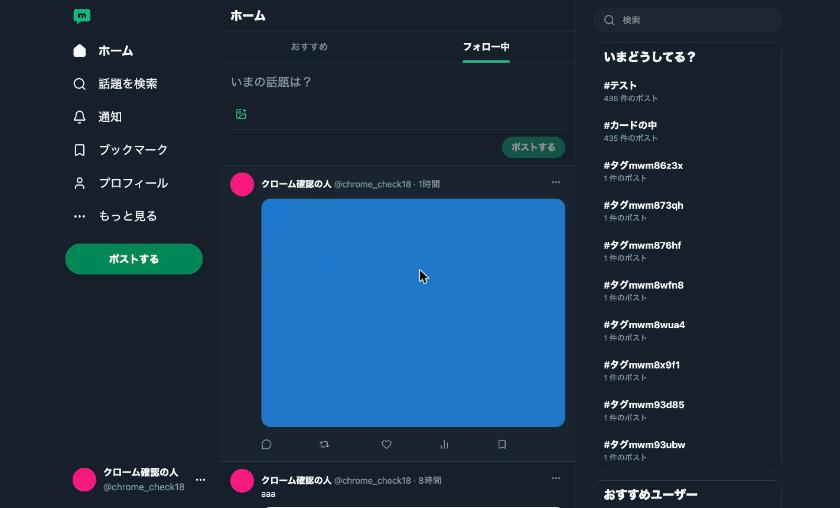

# 試験レポート: 詳細の画面で投稿を削除してから戻ると、消した投稿がまた出る

## 対象

- issue: [#68](https://github.com/ohta-rh/x-modoki-v2/issues/68)（バグ。#34 の探索的テストで見つけた）
- commit: `abc9ab0`、レビューの指摘を直した `870600b`（ブランチ `m1/local-app`、PR #40）
- CI: [実行 44484524397](https://github.com/ohta-rh/x-modoki-v2/actions/runs/44484524397)（成功）
- 日付: 2026-11-19

## 環境

- macOS 26.2、Google Chrome（拡張から操作、と Playwright 1.65.0 の `channel: 'chrome'`）、Node.js 26.12.0（`.nvmrc` は 24。CI の実行を本当の結果とする）、Docker Compose の PostgreSQL
- 動かし方: `pnpm build && pnpm start -p 3001`。Chrome の確認用の架空の人（`chrome_check18`、テーマ dim）と、確かめるために登録した架空の人（`hand_n93d5q`、ライト）

## 判定

合格 — 受け入れ条件 2 件のうち 2 件を満たした。

## 受け入れ条件ごとの結果

| # | 条件 | 確かめ方 | 結果 | エビデンス |
|---|---|---|---|---|
| 1 | 詳細の画面で削除すると履歴を置き換え、「戻る」で消した投稿が出ない | `e2e/post-detail.spec.ts` › 詳細の画面で削除したあと「戻る」でも、消した投稿の詳細は出ない（#68） | 合格 | テストの名前のとおり |
| 2 | CI が緑で、カバレッジが 100% のまま | CI の実行 | 合格 | CI の実行 |

## 自動のテスト

`PORT=3300 pnpm verify` が 0 で終わった（`870600b`）: 単体のテスト 184 ファイル 1033 本、カバレッジ 4 つとも 100%、画面のテスト 327 本（Chromium・Firefox・WebKit）。CI でも同じ 7 つが通った。

### TDD の記録

| # | 振る舞い | 先に書いたテスト | 赤（落ちた理由） | 緑にした実装 |
|---|---|---|---|---|
| 1 | 戻っても消した投稿が出ない（受け入れのテスト） | `e2e/post-detail.spec.ts` › 詳細の画面で削除したあと… | `Expected: 0` `Received: 1`（直したあとも、`push` だけ直した段階で 2、キャッシュを消した段階で、見えない古い画面の分の 1 が残った。見えるものだけを数える形にした） | `post-thread.tsx` |
| 2 | 削除したら `replace('/home')` で移る | `post-thread.test.tsx` › 本体を削除したら、履歴を置き換えて… | `expected "vi.fn()" to be called with arguments: [ '/home' ]` | `post-thread.tsx`（`router.replace`） |
| 3 | どの一覧のキャッシュからも取り除く | `update-post-in-caches.test.ts` › removePostFromCaches（#68） | `expected [ [ '1', '2' ], [ '1', '3' ] ] to deeply equal [ [ '2' ], [ '3' ] ]` | `entities/post/lib/update-post-in-caches.ts`（`removePostFromCaches`） |

## コードレビュー

- 判定: APPROVE（1 回目、#65〜#73 をまとめて）　範囲: `origin/m1/local-app...abc9ab0`　レビューした sub agent: code-reviewer（opus）

| # | 重さ | 指摘 | 確かめた結果 | 対応 |
|---|---|---|---|---|
| 1 | minor | `app-shell.tsx:34` の `currentPath.startsWith('/settings')` は、名前が settings で始まる人のプロフィールにも当たる（`settings_fan` は作れる） | 再現した（`/settings_fan` でボタンが消えるテストが赤） | 直した（`870600b`）。`/settings` と `/settings/` 以下だけを見る。テスト: `app-shell.test.tsx` に `/settings_fan`・`/settings_fan/status/1` を足した |
| 2 | minor | #66 の条件は名前・自己紹介・場所・URL だが、テストは URL を確かめていない | 正しい（今の作りは正しいが、見張りが無い）。URL の NFC を外すと落ちることを確かめた | 直した（`870600b`）。テスト: `schema.test.ts` に `https://ex.test/` + か + U+3099 を足した |

## ブラウザでの確認

| URL | 幅 | テーマ | した操作 | 見えた結果 | 画面の写真 |
|---|---|---|---|---|---|
| `/home?tab=following` | 1422 | dim | 投稿 → 詳細 → 削除 → 戻る | 消した投稿は一覧に無い（見えている記事のうち 0 件） | `68-back-after-delete.jpg` |
| `/home` | 768 | ライト | 開いた（変えていない隣の画面） | 崩れない、横にはみ出さない | `home-768.jpg` |
| `/home` | 375 | ライト | 開いた（変えていない隣の画面） | 崩れない、横にはみ出さない | `home-375.jpg` |

- コンソール: エラー 0、警告 0　通信: 失敗 0（`chrome-evidence.mjs` の読み込みと、Playwright の Chrome での操作。わざと通信を切った間の失敗と、壊れた URL の 404 は除く）
- 1422px の写真は、拡張から操作した Chrome の窓の幅（`innerWidth` で測った）

## 見つけた問題

なし
