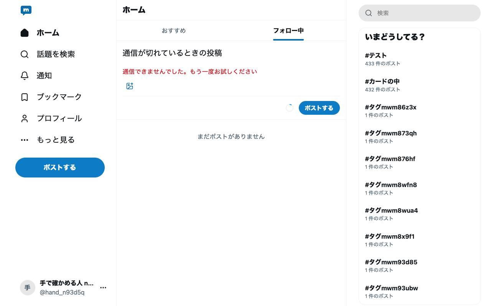
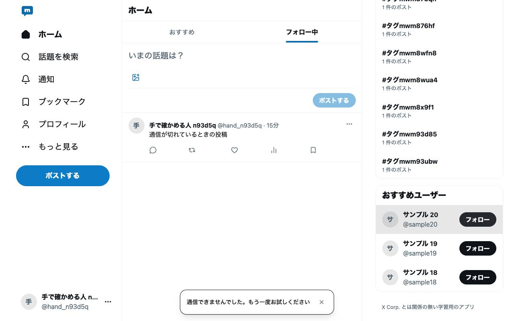

# 試験レポート: 通信が切れていると、投稿で画面全体が英語の誤りに変わり、フォローは黙って失敗する（Server Action の失敗を受け止めていない）

## 対象

- issue: [#70](https://github.com/ohta-rh/x-modoki-v2/issues/70)（バグ。#34 の探索的テストで見つけた）
- commit: `abc9ab0`、レビューの指摘を直した `870600b`（ブランチ `m1/local-app`、PR #40）
- CI: [実行 44484524397](https://github.com/ohta-rh/x-modoki-v2/actions/runs/44484524397)（成功）
- 日付: 2026-11-19

## 環境

- macOS 26.2、Google Chrome（拡張から操作、と Playwright 1.65.0 の `channel: 'chrome'`）、Node.js 26.12.0（`.nvmrc` は 24。CI の実行を本当の結果とする）、Docker Compose の PostgreSQL
- 動かし方: `pnpm build && pnpm start -p 3001`。Chrome の確認用の架空の人（`chrome_check18`、テーマ dim）と、確かめるために登録した架空の人（`hand_n93d5q`、ライト）

## 判定

合格 — 受け入れ条件 4 件のうち 4 件を満たした。

## 受け入れ条件ごとの結果

| # | 条件 | 確かめ方 | 結果 | エビデンス |
|---|---|---|---|---|
| 1 | 通信が切れて要求が失敗すると、どの操作も通信の文言を出し、入力を残す | 各部品の「通信が切れて action が失敗」のテスト（`compose-box`・`delete-post-menu`・`pin-menu-item`・`clear-bookmarks-menu`・`profile-edit-form`）、`settle.test.ts` | 合格 | テストの名前のとおり |
| 2 | フォローの失敗は元に戻してトーストで知らせる | `who-to-follow`・`user-results`・`follow-list-page`・`profile-page` の「通信が切れてフォローが失敗したら」 | 合格 | テストの名前のとおり |
| 3 | オフラインで投稿しても画面が壊れず、つながってから 1 回だけ投稿できる | `e2e/offline.spec.ts` › オフラインで投稿しても… | 合格 | テストの名前のとおり |
| 4 | CI が緑で、カバレッジが 100% のまま | CI の実行 | 合格 | CI の実行 |

## 自動のテスト

`PORT=3300 pnpm verify` が 0 で終わった（`870600b`）: 単体のテスト 184 ファイル 1033 本、カバレッジ 4 つとも 100%、画面のテスト 327 本（Chromium・Firefox・WebKit）。CI でも同じ 7 つが通った。

### TDD の記録

| # | 振る舞い | 先に書いたテスト | 赤（落ちた理由） | 緑にした実装 |
|---|---|---|---|---|
| 1 | オフラインの投稿・フォロー（受け入れのテスト） | `e2e/offline.spec.ts` の 2 本 | `getByText('通信できませんでした。もう一度お試しください')` `Expected: visible` | 下の全部 |
| 2 | 失敗した Promise を失敗の結果にする | `settle.test.ts` › 通信が切れて Promise が失敗したら… | `TypeError: Failed to fetch`（投げたまま） | `src/shared/lib/settle/settle.ts` |
| 3 | 投稿の欄 | `compose-box.test.tsx` › 通信が切れて action が失敗しても… | `Unable to find role="alert"` | `compose-box.tsx` |
| 4 | フォローの 4 か所 | 各テスト › 通信が切れてフォローが失敗したら… | `expected "add" to be called with arguments: [ { title: '通信できませんでした。…' } ]`（4 本） | `who-to-follow.tsx`・`user-results.tsx`・`follow-list.tsx`・`profile-follow-header.tsx` |
| 5 | 削除・固定・全部のブックマークの削除・プロフィールの保存 | 各テスト › 通信が切れて action が失敗… | `Unable to find role="alert"`（3 本）、`expected "add" to be called with …`（固定） | `delete-post-menu.tsx`・`pin-menu-item.tsx`・`clear-bookmarks-menu.tsx`・`profile-edit-form.tsx` |

## コードレビュー

- 判定: APPROVE（1 回目、#65〜#73 をまとめて）　範囲: `origin/m1/local-app...abc9ab0`　レビューした sub agent: code-reviewer（opus）

| # | 重さ | 指摘 | 確かめた結果 | 対応 |
|---|---|---|---|---|
| 1 | minor | `app-shell.tsx:34` の `currentPath.startsWith('/settings')` は、名前が settings で始まる人のプロフィールにも当たる（`settings_fan` は作れる） | 再現した（`/settings_fan` でボタンが消えるテストが赤） | 直した（`870600b`）。`/settings` と `/settings/` 以下だけを見る。テスト: `app-shell.test.tsx` に `/settings_fan`・`/settings_fan/status/1` を足した |
| 2 | minor | #66 の条件は名前・自己紹介・場所・URL だが、テストは URL を確かめていない | 正しい（今の作りは正しいが、見張りが無い）。URL の NFC を外すと落ちることを確かめた | 直した（`870600b`）。テスト: `schema.test.ts` に `https://ex.test/` + か + U+3099 を足した |

## ブラウザでの確認

| URL | 幅 | テーマ | した操作 | 見えた結果 | 画面の写真 |
|---|---|---|---|---|---|
| `/home?tab=following` | 1280 | ライト | オフラインで投稿した | 文言が出て、打った文字が残る。つながってから押すと 1 件だけ投稿された | `70-offline-post-1280.jpg` |
| `/home?tab=following` | 1280 | ライト | オフラインでおすすめユーザーをフォローした | トーストが出て、ボタンはフォローのまま | `70-offline-follow-1280.jpg` |
| `/home` | 768 | ライト | 開いた（変えていない隣の画面） | 崩れない、横にはみ出さない | `home-768.jpg` |
| `/home` | 375 | ライト | 開いた（変えていない隣の画面） | 崩れない、横にはみ出さない | `home-375.jpg` |

- コンソール: エラー 0、警告 0　通信: 失敗 0（`chrome-evidence.mjs` の読み込みと、Playwright の Chrome での操作。わざと通信を切った間の失敗と、壊れた URL の 404 は除く）
- 1422px の写真は、拡張から操作した Chrome の窓の幅（`innerWidth` で測った）

## 見つけた問題

なし
