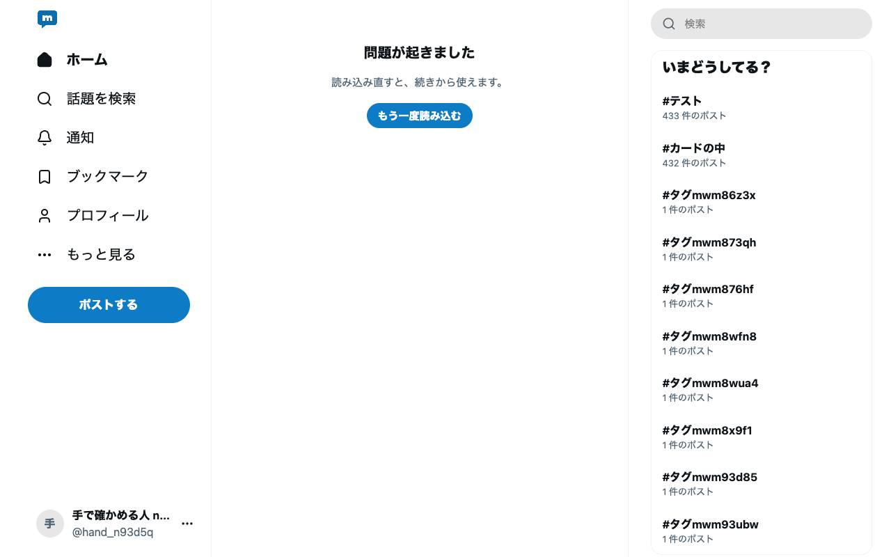

# 試験レポート: 予期しない誤りで、画面が英語の「This page couldn't load」になる（日本語の誤りの画面が無い）

## 対象

- issue: [#71](https://github.com/ohta-rh/x-modoki-v2/issues/71)（バグ。#34 の探索的テストで見つけた）
- commit: `abc9ab0`、レビューの指摘を直した `870600b`（ブランチ `m1/local-app`、PR #40）
- CI: [実行 44484524397](https://github.com/ohta-rh/x-modoki-v2/actions/runs/44484524397)（成功）
- 日付: 2026-11-19

## 環境

- macOS 26.2、Google Chrome（拡張から操作、と Playwright 1.65.0 の `channel: 'chrome'`）、Node.js 26.12.0（`.nvmrc` は 24。CI の実行を本当の結果とする）、Docker Compose の PostgreSQL
- 動かし方: `pnpm build && pnpm start -p 3001`。Chrome の確認用の架空の人（`chrome_check18`、テーマ dim）と、確かめるために登録した架空の人（`hand_n93d5q`、ライト）

## 判定

合格 — 受け入れ条件 3 件のうち 3 件を満たした。

## 受け入れ条件ごとの結果

| # | 条件 | 確かめ方 | 結果 | エビデンス |
|---|---|---|---|---|
| 1 | アプリの中の誤りでは、日本語の「問題が起きました」と「もう一度読み込む」が出て、押すとやり直す | `e2e/error-page.spec.ts` › 誤りの画面は日本語で、もう一度読み込める（#71） | 合格 | テストの名前のとおり |
| 2 | 根のレイアウトの誤り（`global-error`）も日本語で、`<html lang="ja">` | `error-page.test.tsx` › 根のレイアウトの誤りでも… | 合格 | テストの名前のとおり |
| 3 | CI が緑で、カバレッジが 100% のまま | CI の実行 | 合格 | CI の実行 |

## 自動のテスト

`PORT=3300 pnpm verify` が 0 で終わった（`870600b`）: 単体のテスト 184 ファイル 1033 本、カバレッジ 4 つとも 100%、画面のテスト 327 本（Chromium・Firefox・WebKit）。CI でも同じ 7 つが通った。

### TDD の記録

| # | 振る舞い | 先に書いたテスト | 赤（落ちた理由） | 緑にした実装 |
|---|---|---|---|---|
| 1 | 誤りの画面が日本語（受け入れのテスト） | `e2e/error-page.spec.ts` | `getByRole('heading', { name: '問題が起きました' })` `element(s) not found`（英語の「This page couldn't load」） | `app/(main)/error.tsx` |
| 2 | 見出し・説明・読み込み直すボタン | `error-page.test.tsx` の 2 本 | `Unable to find an accessible element with the role "heading" and name "問題が起きました"` | `src/_pages/error/ui/error-page.tsx` |
| 3 | `global-error` が `<html lang="ja">` | `error-page.test.tsx` › 根のレイアウトの誤りでも… | `expected '' to match /^<html lang="ja"><body>/`。緑にするとき、React が空の `<head>` を足すのでテストの期待を直した（テストの誤り） | `GlobalErrorPage`、`app/global-error.tsx` |

## コードレビュー

- 判定: APPROVE（1 回目、#65〜#73 をまとめて）　範囲: `origin/m1/local-app...abc9ab0`　レビューした sub agent: code-reviewer（opus）

| # | 重さ | 指摘 | 確かめた結果 | 対応 |
|---|---|---|---|---|
| 1 | minor | `app-shell.tsx:34` の `currentPath.startsWith('/settings')` は、名前が settings で始まる人のプロフィールにも当たる（`settings_fan` は作れる） | 再現した（`/settings_fan` でボタンが消えるテストが赤） | 直した（`870600b`）。`/settings` と `/settings/` 以下だけを見る。テスト: `app-shell.test.tsx` に `/settings_fan`・`/settings_fan/status/1` を足した |
| 2 | minor | #66 の条件は名前・自己紹介・場所・URL だが、テストは URL を確かめていない | 正しい（今の作りは正しいが、見張りが無い）。URL の NFC を外すと落ちることを確かめた | 直した（`870600b`）。テスト: `schema.test.ts` に `https://ex.test/` + か + U+3099 を足した |

## ブラウザでの確認

| URL | 幅 | テーマ | した操作 | 見えた結果 | 画面の写真 |
|---|---|---|---|---|---|
| `/home` | 1280 | ライト | 続きのページを壊れた形で返して下まで送った | 日本語の誤りの画面。「もう一度読み込む」でホームに戻った | `71-error-page-1280.jpg` |
| `/home` | 768 | ライト | 開いた（変えていない隣の画面） | 崩れない、横にはみ出さない | `home-768.jpg` |
| `/home` | 375 | ライト | 開いた（変えていない隣の画面） | 崩れない、横にはみ出さない | `home-375.jpg` |

- コンソール: エラー 0、警告 0　通信: 失敗 0（`chrome-evidence.mjs` の読み込みと、Playwright の Chrome での操作。わざと通信を切った間の失敗と、壊れた URL の 404 は除く）
- 1422px の写真は、拡張から操作した Chrome の窓の幅（`innerWidth` で測った）

## 見つけた問題

なし
