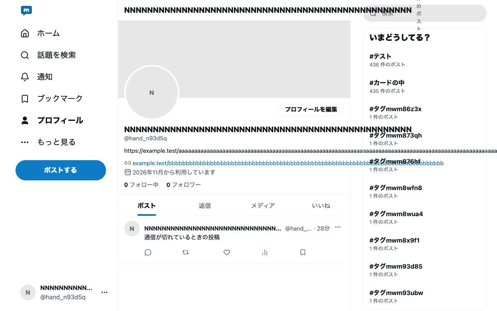
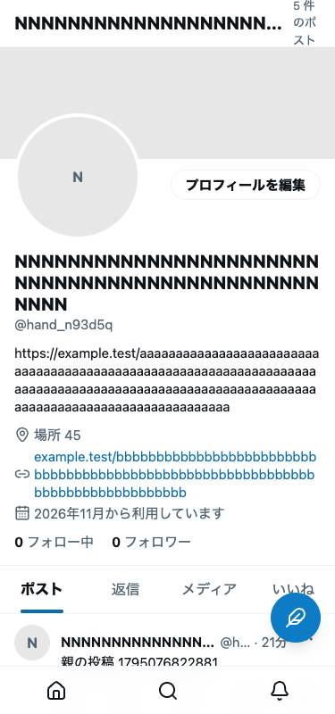
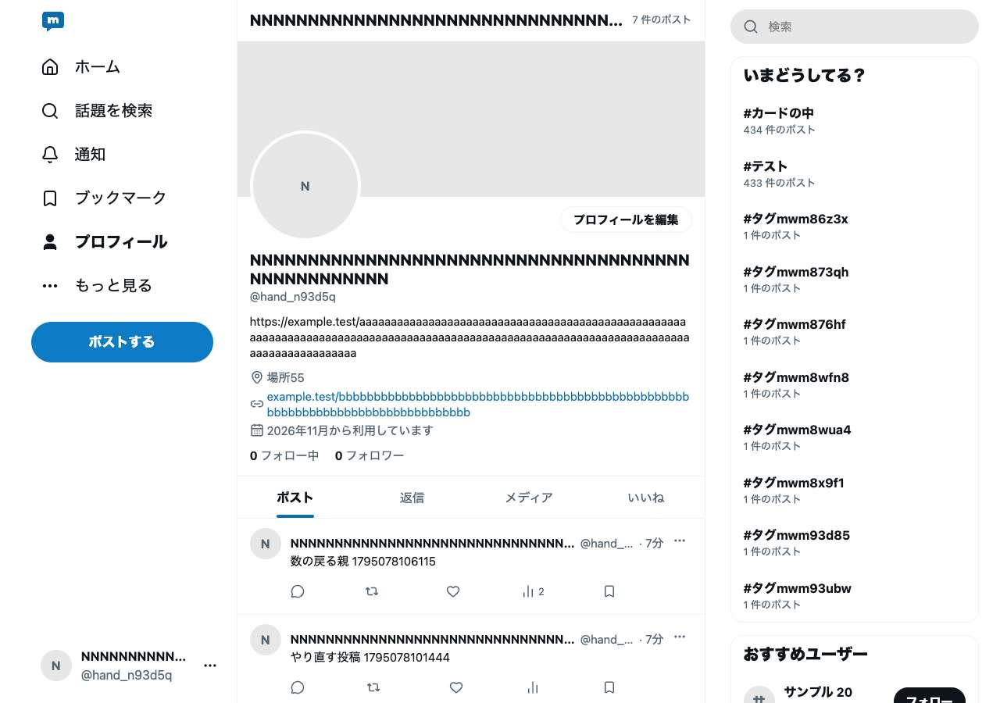
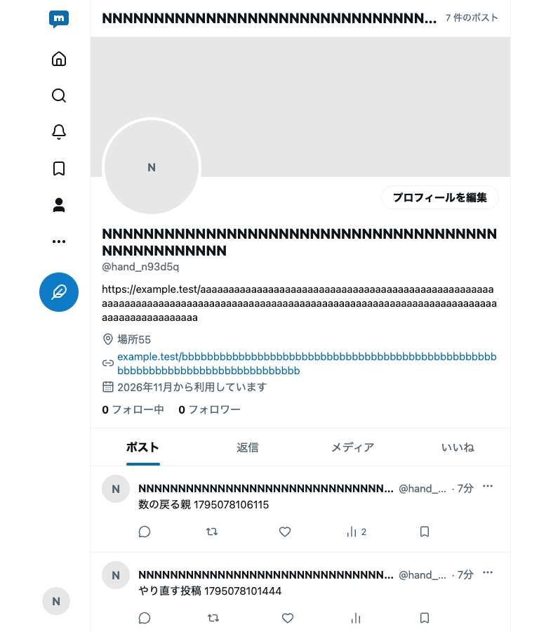
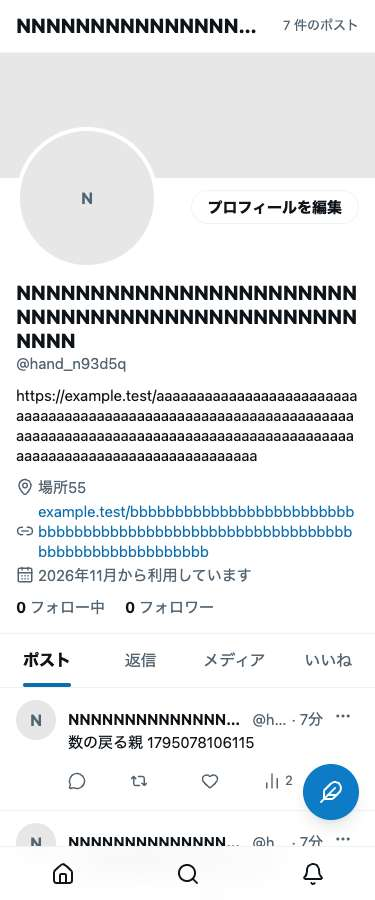
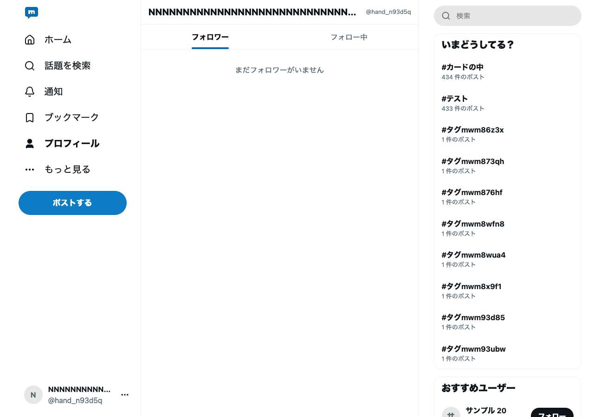
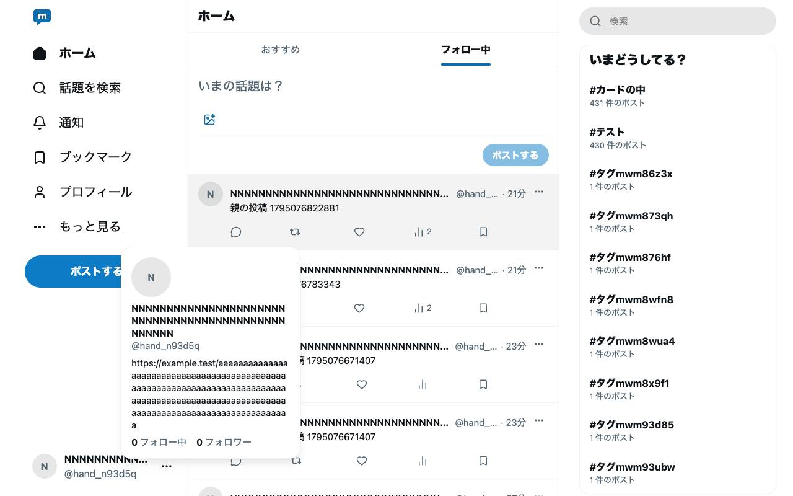

# 試験レポート: 長い名前・自己紹介・URL が、プロフィールと一覧とホバーカードから横にはみ出す

## 対象

- issue: [#74](https://github.com/ohta-rh/x-modoki-v2/issues/74)（バグ。#34 の探索的テストの 2 巡目で見つけた）
- commit: `42860d8`、レビューの指摘を直した `aac24c6`（ブランチ `m1/local-app`、PR #40）
- CI: [実行 44492932183](https://github.com/ohta-rh/x-modoki-v2/actions/runs/44492932183)（成功）
- 日付: 2026-11-19

## 環境

- macOS 26.2、Google Chrome（拡張から操作、と Playwright 1.65.0 の `channel: 'chrome'`）、Node.js 26.12.0（`.nvmrc` は 24。CI の実行を本当の結果とする）、Docker Compose の PostgreSQL
- 動かし方: `pnpm build && pnpm start -p 3001`。Chrome の確認用の架空の人（`chrome_check18`、テーマ dim）と、確かめるために登録した架空の人（`hand_n93d5q`、ライト）

## 判定

合格 — 受け入れ条件 3 件のうち 3 件を満たした。

## 受け入れ条件ごとの結果

| # | 条件 | 確かめ方 | 結果 | エビデンス |
|---|---|---|---|---|
| 1 | 長い名前・自己紹介・URL の人のプロフィール・ユーザーの検索・フォロワーの一覧・ホバーカードが 320px と 1280px で横にはみ出さない | `e2e/narrow.spec.ts` › 長い名前・自己紹介・URL でも…（#74） | 合格 | テストの名前のとおり |
| 2 | 自己紹介と URL は折り返して全部読める。見出しの名前は 1 行で切り詰める | 同上、`profile-header.test.tsx`・`page-header.test.tsx`・`user-hover-card.test.tsx`・`user-results.test.tsx`・`follow-list-page.test.tsx` | 合格 | テストの名前のとおり |
| 3 | CI が緑で、カバレッジが 100% のまま | CI の実行 | 合格 | CI の実行 |

## 自動のテスト

`PORT=3300 pnpm verify` が 0 で終わった（`aac24c6`）: 単体のテスト 185 ファイル 1048 本、カバレッジ 4 つとも 100%、画面のテスト 345 本（Chromium・Firefox・WebKit）。CI でも同じ 7 つが通った。

- その前の 1 回（`42860d8` の前の手元の確かめ）で、WebKit の 1 本の登録が 5 秒で終わらず、続く WebKit の 7 本が打ち切られた。同じ WebKit の 14 本を流し直すと全部通り、そのあとの 3 回の `pnpm verify` も通った。原因は分からない（サーバーの応答が遅れた 1 回）

### TDD の記録

| # | 振る舞い | 先に書いたテスト | 赤（落ちた理由） | 緑にした実装 |
|---|---|---|---|---|
| 1 | 長い文字でも横にはみ出さない（受け入れのテスト） | `e2e/narrow.spec.ts` › 長い名前・自己紹介・URL でも… | `/<user> at 320` `Expected: 0` `Received: 954` | 下の全部 |
| 2 | プロフィールの名前・自己紹介・URL を折り返す | `profile-header.test.tsx` | `expect(element).toHaveClass("break-words")` | `profile-header.tsx`（`break-words`・`break-all`・`min-w-0`） |
| 3 | 見出しの名前を切り詰める | `page-header.test.tsx`（新しい） | `toHaveClass("min-w-0 truncate")` | `page-header.tsx` |
| 4 | ホバーカード・検索・フォローの一覧の名前と自己紹介を折り返す | `user-hover-card.test.tsx`・`user-results.test.tsx`・`follow-list-page.test.tsx` | `expect(element).toHaveClass("break-words")`（4 本） | `user-hover-card-live.tsx`・`user-results.tsx`・`follow-list.tsx` |
| 5 | 見出しの右の数と @ を 1 行に保つ（Chrome で見つけた） | `profile-page.test.tsx`・`follow-list-page.test.tsx`、e2e の数の高さ | `expect(element).toHaveClass("shrink-0 whitespace-nowrap")`（2 本） | `profile-page.tsx`・`follow-list-page.tsx` |
| 6 | フォロワーの一覧もブラウザで確かめる（レビュー 2） | e2e に `/<相手>/followers` を足した | 直したあとに足したので赤は見ていない（2 巡目の B は、直す前のフォロワーの一覧が 320px で幅 820 だったことを測っている） | 変更なし |

## コードレビュー

- 判定: APPROVE（1 回目、#74〜#79 をまとめて）　範囲: `origin/m1/local-app...42860d8`　レビューした sub agent: code-reviewer（opus）

| # | 重さ | 指摘 | 確かめた結果 | 対応 |
|---|---|---|---|---|
| 1 | minor | `use-moved-away.ts` の見張りは、開いてからの全部の `a[href]` のクリックを数える。保存の前のクリックや、新しいタブで開くクリック（Cmd・Ctrl・Shift、`target="_blank"`）のあとに保存すると、プロフィールへ移らない | 再現した（保存の前と Cmd のクリックのテストが赤、`expected "vi.fn()" to be called with arguments: [ '/hanako' ]`） | 直した（`aac24c6`）。フォームを送るたびに見張りを始め直し、別のタブや窓へのクリックは数えない。テスト: `profile-edit.test.tsx` の 4 本 |
| 2 | minor | #74 の条件はフォロワーの一覧を含むが、ブラウザのテストが開いていない | 正しい | 直した（`aac24c6`）。`e2e/narrow.spec.ts` の #74 で、長い名前の人がフォローして `/<相手>/followers` を 320・1280px で開く |
| 3 | minor | #75 の 4 つのダイアログのうち、ブラウザで確かめたのは削除だけ。引用は自分の並べ方を持つ | 正しい（引用は 1 巡目の証拠の閉じるボタンが −12 だったもの） | 直した（`aac24c6`）。`e2e/narrow.spec.ts` の #75 で、引用のダイアログも 320×200 で確かめる |

## ブラウザでの確認

| URL | 幅 | テーマ | した操作 | 見えた結果 | 画面の写真 |
|---|---|---|---|---|---|
| `/hand_n93d5q（直す前）` | 1280 | ライト | 長い名前・自己紹介・URL を保存して開いた | 名前と URL が右の列に重なる（幅 1578） | `r2-overflow-profile-1280.jpg` |
| `/hand_n93d5q（見出しを直す前）` | 375 | ライト | 開いた | 見出しの右の「件のポスト」が 2 行に潰れる | `74-before-header-375.jpg` |
| `/hand_n93d5q` | 1280 | ライト | 開いた | 折り返して収まる | `74-profile-1280.jpg` |
| `/hand_n93d5q` | 768 | ライト | 開いた | 収まる | `74-profile-768.jpg` |
| `/hand_n93d5q` | 375 | ライト | 開いた | 見出しは 1 行で切り詰め、数は 1 行。自己紹介と URL は折り返す | `74-profile-375.jpg` |
| `/hand_n93d5q/followers` | 1280 | ライト | 開いた | 収まる | `74-followers-1280.jpg` |
| `/hand_n93d5q/followers` | 375 | ライト | 開いた | 収まる | `74-followers-375.jpg` |
| `/home?tab=following` | 1280 | ライト | 長い名前の人のアバターにホバーした | カードの右端 484px、横にはみ出さない | `74-hover-1280.jpg` |

- コンソール: エラー 0、警告 0　通信: 失敗 0（`chrome-evidence.mjs` の読み込みと、Playwright の Chrome での操作。わざと通信を切った間の失敗と、壊れた URL の 404 は除く）
- 1400px の写真は、拡張から操作した Chrome の窓の幅

## 見つけた問題

1. 本物の Chrome の 375px で、長い名前に押されて見出しの右の「件のポスト」が 2 行に潰れていた（`74-before-header-375.jpg`）。この PBI の範囲（見出しの名前）なので、テストを先に書いて直した（`shrink-0 whitespace-nowrap`）
