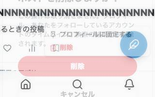
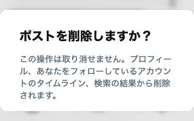
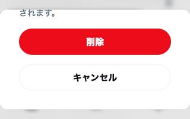

# 試験レポート: 画面より高い確認のダイアログの上と下が切れて、ボタンに届かない

## 対象

- issue: [#75](https://github.com/ohta-rh/x-modoki-v2/issues/75)（バグ。#34 の探索的テストの 2 巡目で見つけた）
- commit: `42860d8`、レビューの指摘を直した `aac24c6`（ブランチ `m1/local-app`、PR #40）
- CI: [実行 44492932183](https://github.com/ohta-rh/x-modoki-v2/actions/runs/44492932183)（成功）
- 日付: 2026-11-19

## 環境

- macOS 26.2、Google Chrome（拡張から操作、と Playwright 1.65.0 の `channel: 'chrome'`）、Node.js 26.12.0（`.nvmrc` は 24。CI の実行を本当の結果とする）、Docker Compose の PostgreSQL
- 動かし方: `pnpm build && pnpm start -p 3001`。Chrome の確認用の架空の人（`chrome_check18`、テーマ dim）と、確かめるために登録した架空の人（`hand_n93d5q`、ライト）

## 判定

合格 — 受け入れ条件 3 件のうち 3 件を満たした。

## 受け入れ条件ごとの結果

| # | 条件 | 確かめ方 | 結果 | エビデンス |
|---|---|---|---|---|
| 1 | 320×200 で、削除・全部のブックマークの削除・引用・破棄の確認のダイアログは、上端が画面の中にあり、中を送ると全部のボタンに届く | `e2e/narrow.spec.ts` › 画面より高いダイアログは…（#75）（削除と引用）、`dialog.test.tsx`（全部が使う元の class） | 合格 | テストの名前のとおり |
| 2 | 大きい画面のダイアログの見た目は変わらない | 既存の `e2e/modals.spec.ts` と Chrome | 合格 | テストの名前のとおり |
| 3 | CI が緑で、カバレッジが 100% のまま | CI の実行 | 合格 | CI の実行 |

## 自動のテスト

`PORT=3300 pnpm verify` が 0 で終わった（`aac24c6`）: 単体のテスト 185 ファイル 1048 本、カバレッジ 4 つとも 100%、画面のテスト 345 本（Chromium・Firefox・WebKit）。CI でも同じ 7 つが通った。

- その前の 1 回（`42860d8` の前の手元の確かめ）で、WebKit の 1 本の登録が 5 秒で終わらず、続く WebKit の 7 本が打ち切られた。同じ WebKit の 14 本を流し直すと全部通り、そのあとの 3 回の `pnpm verify` も通った。原因は分からない（サーバーの応答が遅れた 1 回）

### TDD の記録

| # | 振る舞い | 先に書いたテスト | 赤（落ちた理由） | 緑にした実装 |
|---|---|---|---|---|
| 1 | 上が切れず中を送れる（受け入れのテスト） | `e2e/narrow.spec.ts` › 画面より高いダイアログは… | `Expected: >= 0` `Received: -46.07`。直したあとも画面を縮めた直後を測って落ちたので、並べ直しを `expect.poll` で待つ形に直した（テストの誤り） | `src/shared/ui/kit/dialog.tsx` |
| 2 | 元のダイアログに高さの上限とスクロール | `dialog.test.tsx` › 画面より高い中身でも… | `expect(element).toHaveClass("max-h-[calc(100dvh-2rem)] overflow-y-auto")` | `kit/dialog.tsx` |
| 3 | 引用のダイアログもブラウザで（レビュー 3） | e2e に引用を足した | 直したあとに足したので赤は見ていない（2 巡目の B は、直す前の引用の閉じるボタンが −12 だったことを測っている） | 変更なし |

## コードレビュー

- 判定: APPROVE（1 回目、#74〜#79 をまとめて）　範囲: `origin/m1/local-app...42860d8`　レビューした sub agent: code-reviewer（opus）

| # | 重さ | 指摘 | 確かめた結果 | 対応 |
|---|---|---|---|---|
| 1 | minor | `use-moved-away.ts` の見張りは、開いてからの全部の `a[href]` のクリックを数える。保存の前のクリックや、新しいタブで開くクリック（Cmd・Ctrl・Shift、`target="_blank"`）のあとに保存すると、プロフィールへ移らない | 再現した（保存の前と Cmd のクリックのテストが赤、`expected "vi.fn()" to be called with arguments: [ '/hanako' ]`） | 直した（`aac24c6`）。フォームを送るたびに見張りを始め直し、別のタブや窓へのクリックは数えない。テスト: `profile-edit.test.tsx` の 4 本 |
| 2 | minor | #74 の条件はフォロワーの一覧を含むが、ブラウザのテストが開いていない | 正しい | 直した（`aac24c6`）。`e2e/narrow.spec.ts` の #74 で、長い名前の人がフォローして `/<相手>/followers` を 320・1280px で開く |
| 3 | minor | #75 の 4 つのダイアログのうち、ブラウザで確かめたのは削除だけ。引用は自分の並べ方を持つ | 正しい（引用は 1 巡目の証拠の閉じるボタンが −12 だったもの） | 直した（`aac24c6`）。`e2e/narrow.spec.ts` の #75 で、引用のダイアログも 320×200 で確かめる |

## ブラウザでの確認

| URL | 幅 | テーマ | した操作 | 見えた結果 | 画面の写真 |
|---|---|---|---|---|---|
| `/hand_n93d5q（直す前）` | 320 | ライト | 320×200 で削除の確認を開いた | 見出しが上に切れている（上端 −44） | `r2-dialog-320x200.jpg` |
| `/hand_n93d5q` | 320 | ライト | 320×200 で削除の確認を開いた | 上端 16、下端 184。見出しが見える | `75-dialog-320x200.jpg` |
| `/hand_n93d5q` | 320 | ライト | 中を下まで送った | 「キャンセル」に届き、押して閉じた | `75-dialog-320x200-scrolled.jpg` |

- コンソール: エラー 0、警告 0　通信: 失敗 0（`chrome-evidence.mjs` の読み込みと、Playwright の Chrome での操作。わざと通信を切った間の失敗と、壊れた URL の 404 は除く）
- 1400px の写真は、拡張から操作した Chrome の窓の幅

## 見つけた問題

なし
