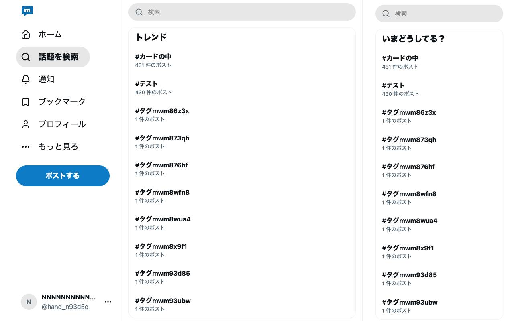

# 試験レポート: プロフィールの保存の途中で押したリンクが捨てられ、保存のあとプロフィールへ移る

## 対象

- issue: [#77](https://github.com/ohta-rh/x-modoki-v2/issues/77)（バグ。#34 の探索的テストの 2 巡目で見つけた）
- commit: `42860d8`、レビューの指摘を直した `aac24c6`（ブランチ `m1/local-app`、PR #40）
- CI: [実行 44492932183](https://github.com/ohta-rh/x-modoki-v2/actions/runs/44492932183)（成功）
- 日付: 2026-11-19

## 環境

- macOS 26.2、Google Chrome（拡張から操作、と Playwright 1.65.0 の `channel: 'chrome'`）、Node.js 26.12.0（`.nvmrc` は 24。CI の実行を本当の結果とする）、Docker Compose の PostgreSQL
- 動かし方: `pnpm build && pnpm start -p 3001`。Chrome の確認用の架空の人（`chrome_check18`、テーマ dim）と、確かめるために登録した架空の人（`hand_n93d5q`、ライト）

## 判定

合格 — 受け入れ条件 3 件のうち 3 件を満たした。

## 受け入れ条件ごとの結果

| # | 条件 | 確かめ方 | 結果 | エビデンス |
|---|---|---|---|---|
| 1 | 保存の間にリンクを押した・戻るを押したときは、保存のあとに移らず、押した先へ行く | `e2e/profile.spec.ts` › 保存の途中で押したリンクの先へ行く（#77）、`profile-edit.test.tsx` | 合格 | テストの名前のとおり |
| 2 | 何も押さなければ、保存のあとプロフィールへ移る（ダイアログは閉じる） | `profile-edit.test.tsx` の既存の 2 本と、保存の前・別のタブのクリックの 4 本 | 合格 | テストの名前のとおり |
| 3 | CI が緑で、カバレッジが 100% のまま | CI の実行 | 合格 | CI の実行 |

## 自動のテスト

`PORT=3300 pnpm verify` が 0 で終わった（`aac24c6`）: 単体のテスト 185 ファイル 1048 本、カバレッジ 4 つとも 100%、画面のテスト 345 本（Chromium・Firefox・WebKit）。CI でも同じ 7 つが通った。

- その前の 1 回（`42860d8` の前の手元の確かめ）で、WebKit の 1 本の登録が 5 秒で終わらず、続く WebKit の 7 本が打ち切られた。同じ WebKit の 14 本を流し直すと全部通り、そのあとの 3 回の `pnpm verify` も通った。原因は分からない（サーバーの応答が遅れた 1 回）

### TDD の記録

| # | 振る舞い | 先に書いたテスト | 赤（落ちた理由） | 緑にした実装 |
|---|---|---|---|---|
| 1 | 押した先へ行く（受け入れのテスト） | `e2e/profile.spec.ts` › 保存の途中で押したリンクの先へ行く | `Expected pattern: /\/explore$/` `Received string: "http://localhost:3300/e2e_…"` | `profile-edit-screens.tsx`・`lib/use-moved-away.ts` |
| 2 | 保存の間のリンクと戻るでは移らない | `profile-edit.test.tsx` › 保存の途中で、ほかへ移ったとき | `expected "vi.fn()" to not be called at all, but actually been called 1 times`。モーダルではリンクに触れないので、モーダルは「戻る」だけにした（テストの前提の誤り） | 同上 |
| 3 | 保存の前のクリック・別のタブのクリックは数えない（レビュー 1） | 同 › 保存を押す前のクリックや… / Ctrl・Shift・target="_blank" | `expected "vi.fn()" to be called with arguments: [ '/hanako' ]`。Ctrl などの 3 本は直したあとに書いたので、条件を外して 4 本とも落ちるのを確かめた | `use-moved-away.ts`（送るたびに始め直す） |

## コードレビュー

- 判定: APPROVE（1 回目、#74〜#79 をまとめて）　範囲: `origin/m1/local-app...42860d8`　レビューした sub agent: code-reviewer（opus）

| # | 重さ | 指摘 | 確かめた結果 | 対応 |
|---|---|---|---|---|
| 1 | minor | `use-moved-away.ts` の見張りは、開いてからの全部の `a[href]` のクリックを数える。保存の前のクリックや、新しいタブで開くクリック（Cmd・Ctrl・Shift、`target="_blank"`）のあとに保存すると、プロフィールへ移らない | 再現した（保存の前と Cmd のクリックのテストが赤、`expected "vi.fn()" to be called with arguments: [ '/hanako' ]`） | 直した（`aac24c6`）。フォームを送るたびに見張りを始め直し、別のタブや窓へのクリックは数えない。テスト: `profile-edit.test.tsx` の 4 本 |
| 2 | minor | #74 の条件はフォロワーの一覧を含むが、ブラウザのテストが開いていない | 正しい | 直した（`aac24c6`）。`e2e/narrow.spec.ts` の #74 で、長い名前の人がフォローして `/<相手>/followers` を 320・1280px で開く |
| 3 | minor | #75 の 4 つのダイアログのうち、ブラウザで確かめたのは削除だけ。引用は自分の並べ方を持つ | 正しい（引用は 1 巡目の証拠の閉じるボタンが −12 だったもの） | 直した（`aac24c6`）。`e2e/narrow.spec.ts` の #75 で、引用のダイアログも 320×200 で確かめる |

## ブラウザでの確認

| URL | 幅 | テーマ | した操作 | 見えた結果 | 画面の写真 |
|---|---|---|---|---|---|
| `/explore` | 1280 | ライト | 保存を 2 秒遅らせ、その間に「話題を検索」を押した | 保存のあとも /explore のまま | `77-explore-1280.jpg` |
| `/home` | 768 | ライト | 開いた（変えていない隣の画面） | 崩れない、横にはみ出さない | `home-768.jpg` |
| `/home` | 375 | ライト | 開いた（変えていない隣の画面） | 崩れない、横にはみ出さない | `home-375.jpg` |

- コンソール: エラー 0、警告 0　通信: 失敗 0（`chrome-evidence.mjs` の読み込みと、Playwright の Chrome での操作。わざと通信を切った間の失敗と、壊れた URL の 404 は除く）
- 1400px の写真は、拡張から操作した Chrome の窓の幅

## 見つけた問題

なし
