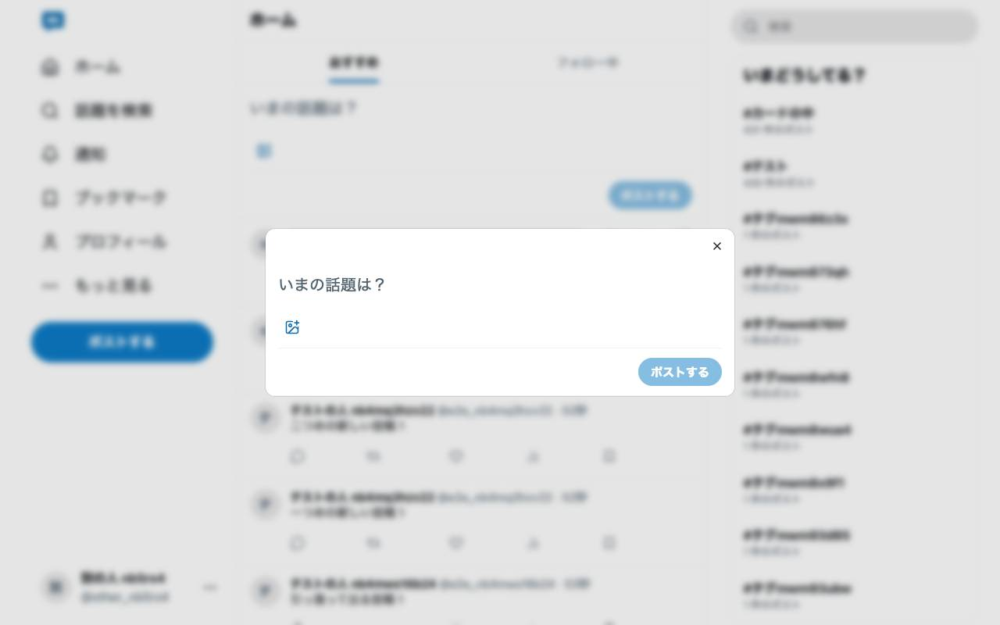

# 試験レポート: 保存した投稿の下書きが、同じブラウザで次にログインした別の人に出る

## 対象

- issue: [#79](https://github.com/ohta-rh/x-modoki-v2/issues/79)（バグ。#34 の探索的テストの 2 巡目で見つけた）
- commit: `42860d8`、レビューの指摘を直した `aac24c6`（ブランチ `m1/local-app`、PR #40）
- CI: [実行 44492932183](https://github.com/ohta-rh/x-modoki-v2/actions/runs/44492932183)（成功）
- 日付: 2026-11-19

## 環境

- macOS 26.2、Google Chrome（拡張から操作、と Playwright 1.65.0 の `channel: 'chrome'`）、Node.js 26.12.0（`.nvmrc` は 24。CI の実行を本当の結果とする）、Docker Compose の PostgreSQL
- 動かし方: `pnpm build && pnpm start -p 3001`。Chrome の確認用の架空の人（`chrome_check18`、テーマ dim）と、確かめるために登録した架空の人（`hand_n93d5q`、ライト）

## 判定

合格 — 受け入れ条件 4 件のうち 4 件を満たした。

## 受け入れ条件ごとの結果

| # | 条件 | 確かめ方 | 結果 | エビデンス |
|---|---|---|---|---|
| 1 | 下書きは人ごとに分けて置き、別の人の投稿の欄には出ない | `e2e/composer-modal.spec.ts` › 下書きは、同じブラウザの別の人に出ない（#79）、`draft.test.ts` | 合格 | テストの名前のとおり |
| 2 | 同じ人が次にログインしたときは、自分の下書きが出る | `draft.test.ts` › 下書きは人ごとに分けて置き… | 合格 | テストの名前のとおり |
| 3 | 前の形の 1 つの鍵の下書きは、読むときに消し、誰にも出さない | `draft.test.ts` › 前の形の、人を分けない下書きは… | 合格 | テストの名前のとおり |
| 4 | CI が緑で、カバレッジが 100% のまま | CI の実行 | 合格 | CI の実行 |

## 自動のテスト

`PORT=3300 pnpm verify` が 0 で終わった（`aac24c6`）: 単体のテスト 185 ファイル 1048 本、カバレッジ 4 つとも 100%、画面のテスト 345 本（Chromium・Firefox・WebKit）。CI でも同じ 7 つが通った。

- その前の 1 回（`42860d8` の前の手元の確かめ）で、WebKit の 1 本の登録が 5 秒で終わらず、続く WebKit の 7 本が打ち切られた。同じ WebKit の 14 本を流し直すと全部通り、そのあとの 3 回の `pnpm verify` も通った。原因は分からない（サーバーの応答が遅れた 1 回）

### TDD の記録

| # | 振る舞い | 先に書いたテスト | 赤（落ちた理由） | 緑にした実装 |
|---|---|---|---|---|
| 1 | 別の人に出ない（受け入れのテスト） | `e2e/composer-modal.spec.ts` › 下書きは、同じブラウザの別の人に出ない | `Expected: ""` `Received: "ほかの人に見せない下書き"` | `draft.ts`・`composer.tsx` |
| 2 | 人ごとに分けて置く | `draft.test.ts` › 下書きは人ごとに… | `expected 'hana' to be '書きかけ'`（ユーザー名を本文として置いていた） | `draft.ts`（`x-modoki:compose-draft:<username>`） |
| 3 | 前の鍵を消す | `draft.test.ts` › 前の形の… | `expected '前の人の下書き' to be ''` | `draft.ts` |
| 4 | 部品のテストの鍵（鍵の形を変えたので合わせた） | `composer.test.tsx`・`compose-page.test.tsx` | 前の鍵では `expected null to be '書きかけ'` | 変更なし（テストの鍵を人ごとにした） |

## コードレビュー

- 判定: APPROVE（1 回目、#74〜#79 をまとめて）　範囲: `origin/m1/local-app...42860d8`　レビューした sub agent: code-reviewer（opus）

| # | 重さ | 指摘 | 確かめた結果 | 対応 |
|---|---|---|---|---|
| 1 | minor | `use-moved-away.ts` の見張りは、開いてからの全部の `a[href]` のクリックを数える。保存の前のクリックや、新しいタブで開くクリック（Cmd・Ctrl・Shift、`target="_blank"`）のあとに保存すると、プロフィールへ移らない | 再現した（保存の前と Cmd のクリックのテストが赤、`expected "vi.fn()" to be called with arguments: [ '/hanako' ]`） | 直した（`aac24c6`）。フォームを送るたびに見張りを始め直し、別のタブや窓へのクリックは数えない。テスト: `profile-edit.test.tsx` の 4 本 |
| 2 | minor | #74 の条件はフォロワーの一覧を含むが、ブラウザのテストが開いていない | 正しい | 直した（`aac24c6`）。`e2e/narrow.spec.ts` の #74 で、長い名前の人がフォローして `/<相手>/followers` を 320・1280px で開く |
| 3 | minor | #75 の 4 つのダイアログのうち、ブラウザで確かめたのは削除だけ。引用は自分の並べ方を持つ | 正しい（引用は 1 巡目の証拠の閉じるボタンが −12 だったもの） | 直した（`aac24c6`）。`e2e/narrow.spec.ts` の #75 で、引用のダイアログも 320×200 で確かめる |

## ブラウザでの確認

| URL | 幅 | テーマ | した操作 | 見えた結果 | 画面の写真 |
|---|---|---|---|---|---|
| `/home` | 1280 | ライト | 1 人目が下書きを保存し、cookie を消して 2 人目が登録して「ポストする」を開いた | 欄は空。localStorage の鍵は `x-modoki:compose-draft:hand_n93d5q` だけ | `79-other-person-1280.jpg` |
| `/home` | 768 | ライト | 開いた（変えていない隣の画面） | 崩れない、横にはみ出さない | `home-768.jpg` |
| `/home` | 375 | ライト | 開いた（変えていない隣の画面） | 崩れない、横にはみ出さない | `home-375.jpg` |

- コンソール: エラー 0、警告 0　通信: 失敗 0（`chrome-evidence.mjs` の読み込みと、Playwright の Chrome での操作。わざと通信を切った間の失敗と、壊れた URL の 404 は除く）
- 1400px の写真は、拡張から操作した Chrome の窓の幅

## 見つけた問題

なし
