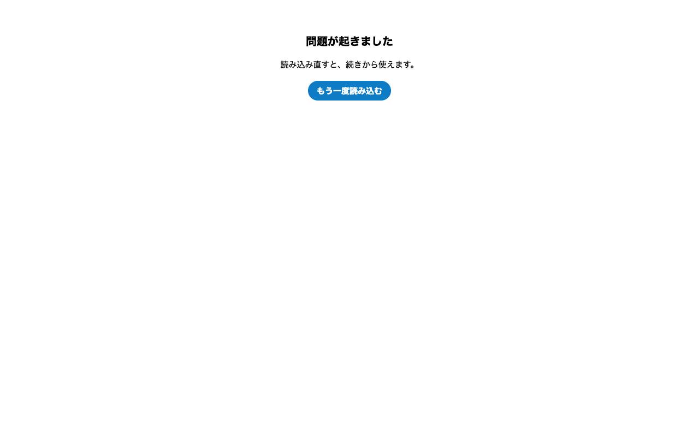

# 試験レポート: 通信が切れていると、ログインと登録で画面が誤りの画面に変わり、ログアウトは黙って失敗する

## 対象

- issue: [#82](https://github.com/ohta-rh/x-modoki-v2/issues/82)（バグ。#34 の探索的テストの 3 巡目で見つけた）
- commit: `1b8a8d2`、レビューの指摘を直した `8396eca`（ブランチ `m1/local-app`、PR #40）
- CI: [実行 44506138255](https://github.com/ohta-rh/x-modoki-v2/actions/runs/44506138255)（成功）
- 日付: 2026-11-19

## 環境

- macOS 26.2、Google Chrome（拡張から操作、と Playwright 1.65.0 の `channel: 'chrome'`）、Node.js 26.12.0（`.nvmrc` は 24。CI の実行を本当の結果とする）、Docker Compose の PostgreSQL
- 動かし方: `pnpm build && pnpm start -p 3001`。Chrome の確認用の架空の人（`chrome_check18`、テーマ dim）と、確かめるために登録した架空の人（`hand_n93d5q`、ライト）

## 判定

合格 — 受け入れ条件 4 件のうち 4 件を満たした。

## 受け入れ条件ごとの結果

| # | 条件 | 確かめ方 | 結果 | エビデンス |
|---|---|---|---|---|
| 1 | オフラインのログインと登録は文言を出し、入れた値（パスワード以外）を残す | `e2e/offline.spec.ts` › オフラインのログイン・登録・ログアウトは…（#82）、`auth-forms.test.tsx` | 合格 | テストの名前のとおり |
| 2 | オフラインのログアウトはトーストで知らせ、ログインしたまま | 同上、`account-menu.test.tsx` | 合格 | テストの名前のとおり |
| 3 | 受けない Server Action の呼び出しを ESLint のルールが止める | `eslint-rules/index.test.mjs` › settle-server-actions、`pnpm lint` | 合格 | テストの名前のとおり |
| 4 | CI が緑で、カバレッジが 100% のまま | CI の実行 | 合格 | CI の実行 |

## 自動のテスト

`PORT=3300 pnpm verify` が 0 で終わった。#80・#81 だけの `2a3750f` で単体のテスト 1049 本・画面のテスト 351 本、#82 を足した `8396eca` で単体のテスト 185 ファイル 1082 本・画面のテスト 357 本（Chromium・Firefox・WebKit）、カバレッジは 4 つとも 100%。CI でも同じ 7 つが通った。

- 手元の WebKit（ADR-0052 の Docker の中の WebKit）が、ほかのブラウザと並べて流したときにだけ、登録やダイアログで 30 秒の時間切れになることが今日 2 回あった。WebKit だけで流し直すと全部通る。原因は分からない。CI では起きていない

### TDD の記録

| # | 振る舞い | 先に書いたテスト | 赤（落ちた理由） | 緑にした実装 |
|---|---|---|---|---|
| 1 | オフラインのログイン・登録・ログアウト（受け入れのテスト） | `e2e/offline.spec.ts` › オフラインのログイン・登録・ログアウトは… | `getByRole('alert')` に文言が無い（誤りの画面に変わった）。直したあと、Next.js の移動の告知の `alert` と、隠れた画面の文言に当たったので、探し方を絞った（テストの誤り） | `sign-in-form.tsx`・`sign-up-form.tsx`・`account-menu.tsx` |
| 2 | 登録とログインのフォーム | `auth-forms.test.tsx` の 2 本 | `Unable to find role="alert"` | `settle` で包み、値を `FormData` から残す |
| 3 | ログアウトのトースト | `account-menu.test.tsx` | `expected "add" to be called with arguments: [ { title: '通信できませんでした。…' } ]` | `.catch` でトースト |
| 4 | ESLint のルール | `eslint-rules/index.test.mjs` › settle-server-actions | 何もしないルールで `Should have 1 error but had 0`（6 本）。TS の `!` と、呼ばない受け手の 2 本は後から書き、壊して落ちるのを確かめた | `eslint-rules/index.mjs`（`local/settle-server-actions`） |
| 5 | redirect は失敗にしない（レビュー 1） | `settle.test.ts`・`account-menu.test.tsx`・e2e › 登録とログアウトが通ったときは… | `promise resolved "{ ok: false }" instead of rejecting`、`expected "add" to not be called`、`Expected: 0 Received: 1` | `settle.ts`・`account-menu.tsx`（`unstable_rethrow`） |
| 6 | 通知の既読（レビュー 2） | `notification-list.test.tsx` › 通信が切れて既読の要求が失敗しても…、`pnpm lint` | `Unhandled Rejection: TypeError: Failed to fetch`、名前を変えると lint の誤り | `notification-list.tsx`（`markReadAction`、`settle`） |
| 7 | 返して任せる形を名前の付いた関数に限る（レビュー 3） | `eslint-rules/index.test.mjs` の 4 本 | `Should have 1 error but had 0`（3 本）、名前の無い矢印関数は後から書いた | `eslint-rules/index.mjs`、`composer.tsx` の `sendAction`、`main-post-reactions.tsx` の名前 |
| 8 | JSX の子の矢印関数で落ちない（レビュー 5） | 同 › JSX の子の矢印関数で返す | `TypeError: Cannot read properties of undefined (reading 'name')` | `eslint-rules/index.mjs` |

## コードレビュー

- 判定: APPROVE（#80・#81 は 4 回目、#82 は 5 回目）　範囲: 1〜3 回目は #80〜#82 をまとめて `origin/m1/local-app...8e90d5e`・`…da59258`・`…33448dd`。3 回で通らなかったので、決まり（`.claude/rules/code-review.md` の 7）どおり、push していない変更を #80・#81（`2a3750f`）と #82（`1b8a8d2`）に分け、それぞれ新しい reviewer に出した　レビューした sub agent: code-reviewer（opus）

| # | 回 | 重さ | 指摘 | 確かめた結果 | 対応 |
|---|---|---|---|---|---|
| 1 | 1 | blocker | ログアウトが成功しても、Next.js が `redirect` で Promise を拒むので、`.catch` が通信のトーストを出す | 再現した（オンラインのログアウトでトースト。単体のテストが赤） | 直した（`da59258`）。`unstable_rethrow` で移動の誤りを投げ直す |
| 2 | 1 | blocker | 登録とログインの成功でも `settle` が redirect を失敗にし、隠れた画面に通信の文言が残る | 再現した（成功のあと「戻る」で文言。e2e が赤 `Expected: 0 Received: 1`） | 直した（`da59258`）。`settle` が Next.js の制御の誤りを投げ直す |
| 3 | 2 | major | 通知の既読の `markRead` が名前の決まりから外れ、失敗を受けていない（ルールが見えない） | 再現した（拒まれると捕まえていない拒否） | 直した（`33448dd`）。`markReadAction` にし、`settle` で受ける |
| 4 | 2 | minor | #80 の全部の画面を回るテストが、#31 の画面の半分を回っていない | 正しい | 直した（`33448dd`）。#31 と同じ画面を全部回る |
| 5 | 3 | major | ルールが、矢印関数の本体や `return` を全部許すので、`onClick={() => signOut()}` を見逃す | 再現した（ルールのテストが赤 3 本） | 直した（#82 の `1b8a8d2`）。名前が action の関数で返すときだけ許す |
| 6 | 4（#80・#81） | — | 指摘なし（APPROVE） | — | — |
| 7 | 5（#82） | minor | JSX の子の矢印関数で、ルールが報告せずに落ちる | 再現した（`TypeError: Cannot read properties of undefined (reading 'name')`） | 直した（`8396eca`）。テストを足した |

## ブラウザでの確認

| URL | 幅 | テーマ | した操作 | 見えた結果 | 画面の写真 |
|---|---|---|---|---|---|
| `/i/flow/login（直す前）` | 1280 | ライト | オフラインでログイン | 「問題が起きました」の画面に変わる | `before-signin-offline-1280.jpg` |
| `/i/flow/login` | 1280 | ライト | 同じ | 文言が出て、入れた名前が残る | `after-signin-offline-1280.jpg` |
| `/` | 1280 | ライト | オンラインで登録 → 戻る → ログアウト | 通信の文言はどこにも出ない。コンソールの誤り 0 | `82-online-signout-1280.jpg` |
| `/home` | 768 | ライト | 開いた（変えていない隣の画面） | 崩れない、横にはみ出さない | `home-768.jpg` |
| `/home` | 375 | ライト | 開いた（変えていない隣の画面） | 崩れない、横にはみ出さない | `home-375.jpg` |

- コンソール: エラー 0、警告 0　通信: 失敗 0（`chrome-evidence.mjs` の読み込みと、Playwright の Chrome での操作。わざと通信を切った間の失敗と、壊れた URL の 404 は除く）
- 1400px の写真は、拡張から操作した Chrome の窓の幅

## 見つけた問題

なし
