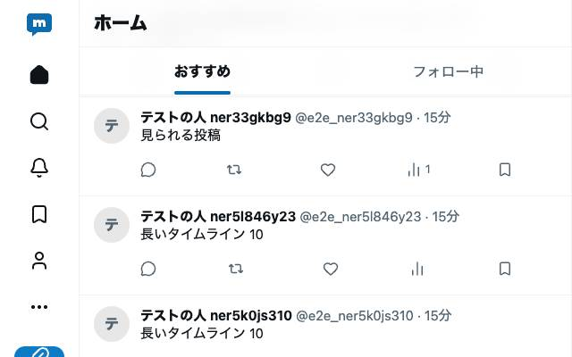
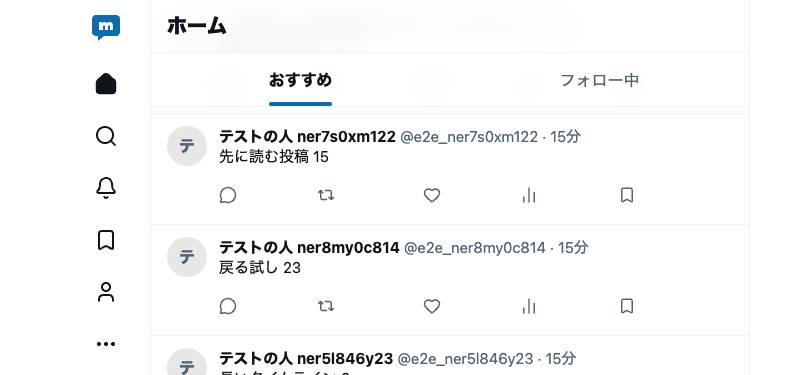
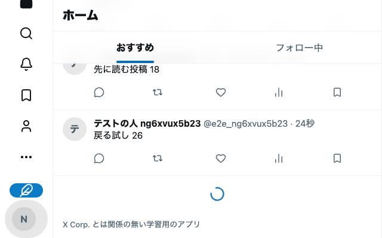
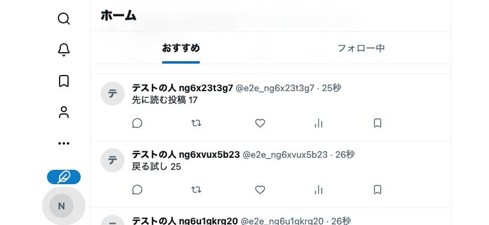
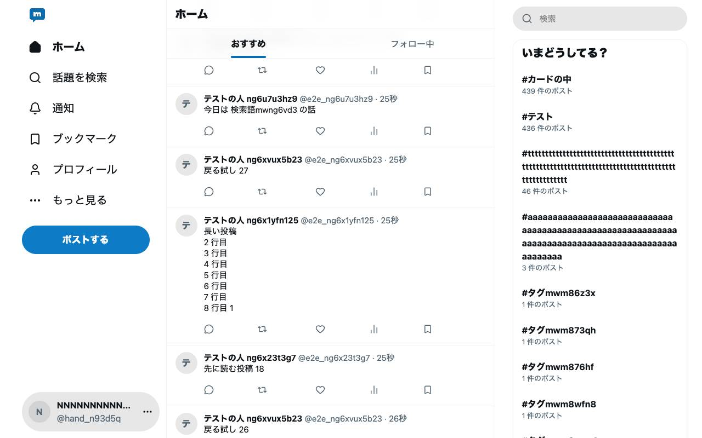

# 試験レポート: 低い画面（200% の拡大・横向きのスマートフォン）で、左の列の下のアカウントのメニューに届かず、ログアウトできない

## 対象

- issue: [#83](https://github.com/ohta-rh/x-modoki-v2/issues/83)（バグ。#34 の探索的テストの 4 巡目で見つけた）
- commit: `48443e7`（ブランチ `m1/local-app`、PR #40）
- CI: [実行 44512771978](https://github.com/ohta-rh/x-modoki-v2/actions/runs/44512771978)（成功）
- 日付: 2026-11-19

## 環境

- macOS 26.2、Google Chrome（拡張から操作、と Playwright 1.65.0 の `channel: 'chrome'`）、Node.js 26.12.0（`.nvmrc` は 24。CI の実行を本当の結果とする）、Docker Compose の PostgreSQL
- 動かし方: `pnpm build && pnpm start -p 3001`。Chrome の確認用の架空の人（`chrome_check18`、テーマ dim）と、確かめるために登録した架空の人（`hand_n93d5q`、ライト）

## 判定

合格 — 受け入れ条件 3 件のうち 3 件を満たした。

## 受け入れ条件ごとの結果

| # | 条件 | 確かめ方 | 結果 | エビデンス |
|---|---|---|---|---|
| 1 | 640×400 と 812×375 で、左の列の中を送ってアカウントのメニューを開き、ログアウトに届く | `e2e/narrow.spec.ts` › 低い画面の左の列（#83）の 2 本 | 合格 | テストの名前のとおり |
| 2 | 1280×800 の左の列の見た目は変わらない | 既存の Playwright と Chrome | 合格 | テストの名前のとおり |
| 3 | CI が緑で、カバレッジが 100% のまま | CI の実行 | 合格 | CI の実行 |

## 自動のテスト

`PORT=3300 pnpm verify` が 0 で終わった（`48443e7`）: 単体のテスト 185 ファイル 1084 本、カバレッジ 4 つとも 100%、画面のテスト 366 本（Chromium・Firefox・WebKit）。CI でも同じ 7 つが通った。

- この PBI の途中で、手元の WebKit の時間切れの原因（Docker の WebKit のコンテナにゾンビのプロセスが 4,683 個）を突き止め、`init: true` で直した（#34 の記録の 6.5 節）。直したあとの全部の確認では、時間切れもゾンビも 0

### TDD の記録

| # | 振る舞い | 先に書いたテスト | 赤（落ちた理由） | 緑にした実装 |
|---|---|---|---|---|
| 1 | 低い画面でメニューに届く（受け入れのテスト） | `e2e/narrow.spec.ts` › 低い画面の左の列（#83） | `toBeInViewport()` `Received: viewport ratio 0` | `app-shell.tsx` |
| 2 | 左の列は中を送れる | `app-shell.test.tsx` › 左の列は、画面より高いと中を送れる… | `expect(element).toHaveClass("sticky h-screen overflow-y-auto")` | `app-shell.tsx`（`overflow-y-auto`） |

## コードレビュー

- 判定: APPROVE（1 回目、#83・#84 をまとめて）　範囲: `origin/m1/local-app...48443e7`　レビューした sub agent: code-reviewer（opus）

| # | 重さ | 指摘 | 確かめた結果 | 対応 |
|---|---|---|---|---|
| — | — | 指摘なし（左の列の `overflow-y-auto` がフォーカスの輪を切らないこと、同時の削除で数が 1 回だけ減ることも確かめた） | — | — |

## ブラウザでの確認

| URL | 幅 | テーマ | した操作 | 見えた結果 | 画面の写真 |
|---|---|---|---|---|---|
| `/home（直す前）` | 640 | ライト | 640×400 で開いた | アカウントのボタンが画面の外（y=416〜480）、送っても届かない | `before-rail-640x400.jpg` |
| `/home（直す前）` | 812 | ライト | 812×375 で開いた | 同じ | `before-rail-812x375.jpg` |
| `/home` | 640 | ライト | 640×400 で左の列を送った | アカウントのボタンに届き、押せる | `after-rail-640x400.jpg` |
| `/home` | 812 | ライト | 812×375 | 押せる | `after-rail-812x375.jpg` |
| `/home` | 1280 | ライト | 1280×800 | 見た目は変わらない | `after-rail-1280x800.jpg` |

- コンソール: エラー 0、警告 0　通信: 失敗 0（`chrome-evidence.mjs` の読み込みと、Playwright の Chrome での操作。わざと通信を切った間の失敗と、壊れた URL の 404 は除く）
- 1400px の写真は、拡張から操作した Chrome の窓の幅

## 見つけた問題

なし
