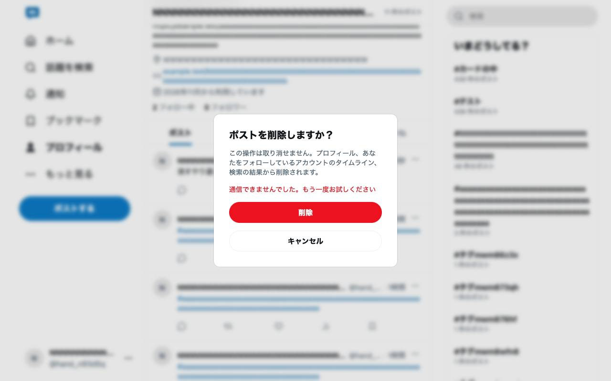
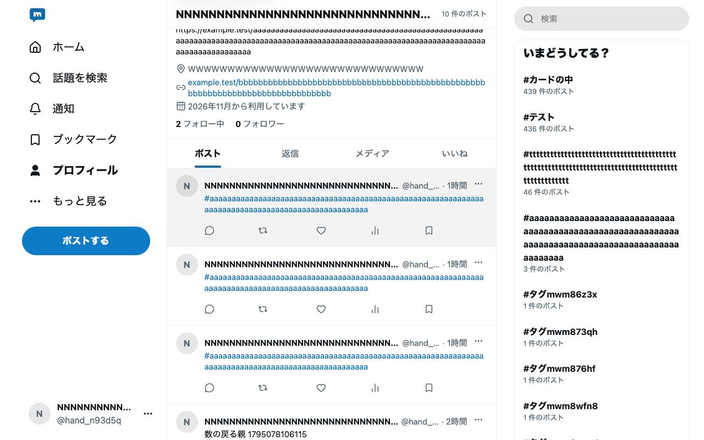

# 試験レポート: 削除の応答が届かずにやり直すと「この投稿は見つかりません」で止まり、消えた投稿が画面に残る

## 対象

- issue: [#84](https://github.com/ohta-rh/x-modoki-v2/issues/84)（バグ。#34 の探索的テストの 4 巡目で見つけた）
- commit: `48443e7`（ブランチ `m1/local-app`、PR #40）
- CI: [実行 44512771978](https://github.com/ohta-rh/x-modoki-v2/actions/runs/44512771978)（成功）
- 日付: 2026-11-19

## 環境

- macOS 26.2、Google Chrome（拡張から操作、と Playwright 1.65.0 の `channel: 'chrome'`）、Node.js 26.12.0（`.nvmrc` は 24。CI の実行を本当の結果とする）、Docker Compose の PostgreSQL
- 動かし方: `pnpm build && pnpm start -p 3001`。Chrome の確認用の架空の人（`chrome_check18`、テーマ dim）と、確かめるために登録した架空の人（`hand_n93d5q`、ライト）

## 判定

合格 — 受け入れ条件 4 件のうち 4 件を満たした。

## 受け入れ条件ごとの結果

| # | 条件 | 確かめ方 | 結果 | エビデンス |
|---|---|---|---|---|
| 1 | 作者がもう消した自分の投稿を消すと、成功を返し、数は 1 回だけ減る | `delete-post.test.ts` › 自分のもう消した投稿をもう一度消すと… / 同じ投稿を同時に何回消しても… | 合格 | テストの名前のとおり |
| 2 | 無い投稿と、他人の消された投稿は NOT_FOUND | `delete-post.test.ts` › 無い投稿と、他人の削除済みの投稿は NOT_FOUND | 合格 | テストの名前のとおり |
| 3 | 応答が失われた削除をやり直すと、ダイアログが閉じ、投稿が一覧から消える | `e2e/offline.spec.ts` › 削除の応答が届かずにやり直しても、投稿は消える（#84） | 合格 | テストの名前のとおり |
| 4 | CI が緑で、カバレッジが 100% のまま | CI の実行 | 合格 | CI の実行 |

## 自動のテスト

`PORT=3300 pnpm verify` が 0 で終わった（`48443e7`）: 単体のテスト 185 ファイル 1084 本、カバレッジ 4 つとも 100%、画面のテスト 366 本（Chromium・Firefox・WebKit）。CI でも同じ 7 つが通った。

- この PBI の途中で、手元の WebKit の時間切れの原因（Docker の WebKit のコンテナにゾンビのプロセスが 4,683 個）を突き止め、`init: true` で直した（#34 の記録の 6.5 節）。直したあとの全部の確認では、時間切れもゾンビも 0

### TDD の記録

| # | 振る舞い | 先に書いたテスト | 赤（落ちた理由） | 緑にした実装 |
|---|---|---|---|---|
| 1 | やり直すと消える（受け入れのテスト） | `e2e/offline.spec.ts` › 削除の応答が届かずにやり直しても… | `getByRole('alertdialog')` `Expected: 0` `Received: 1` | `delete-post.ts` |
| 2 | もう消した自分の投稿は成功 | `delete-post.test.ts` › 自分のもう消した投稿をもう一度消すと… | `expected { ok: false, error: 'NOT_FOUND' } to deeply equal { ok: true }` | `delete-post.ts`（作者なら成功） |
| 3 | 同時の削除はどれも成功（前は 1 つだけ） | 同 › 同じ投稿を同時に何回消しても… | `expected false to be true`（前のテストは「ほかは NOT_FOUND」を確かめていた。この PBI で振る舞いを変えたので期待を直した） | `delete-post.ts`（更新が 0 行でも成功） |

## コードレビュー

- 判定: APPROVE（1 回目、#83・#84 をまとめて）　範囲: `origin/m1/local-app...48443e7`　レビューした sub agent: code-reviewer（opus）

| # | 重さ | 指摘 | 確かめた結果 | 対応 |
|---|---|---|---|---|
| — | — | 指摘なし（左の列の `overflow-y-auto` がフォーカスの輪を切らないこと、同時の削除で数が 1 回だけ減ることも確かめた） | — | — |

## ブラウザでの確認

| URL | 幅 | テーマ | した操作 | 見えた結果 | 画面の写真 |
|---|---|---|---|---|---|
| `/hand_n93d5q` | 1280 | ライト | 削除の応答だけを切った | ダイアログに通信の文言。カードは残る | `84-first-cut-1280.jpg` |
| `/hand_n93d5q` | 1280 | ライト | もう一度「削除」 | ダイアログが閉じ、投稿は一覧に無い | `84-after-retry-1280.jpg` |
| `/home` | 768 | ライト | 開いた（変えていない隣の画面） | 崩れない、横にはみ出さない | `home-768.jpg` |
| `/home` | 375 | ライト | 開いた（変えていない隣の画面） | 崩れない、横にはみ出さない | `home-375.jpg` |

- コンソール: エラー 0、警告 0　通信: 失敗 0（`chrome-evidence.mjs` の読み込みと、Playwright の Chrome での操作。わざと通信を切った間の失敗と、壊れた URL の 404 は除く）
- 1400px の写真は、拡張から操作した Chrome の窓の幅

## 見つけた問題

1. 手元の `pnpm verify` の WebKit が、30 秒の時間切れで今日 3 回止まった。Docker の WebKit のコンテナ（ADR-0052）の最初のプロセスが `npm` で子を回収しないため、閉じた WebKit がゾンビとして 4,683 個溜まっていた。`docker-compose.yml` に `init: true` を足し、`scripts/quality-gates.test.ts` で確かめる（先に落とした: `expected … to match /webkit:\n(\s+\S.*\n)*?\s+init: true\n/`）。直したあと、WebKit の 123 本と全部の確認のあとでゾンビは 0
