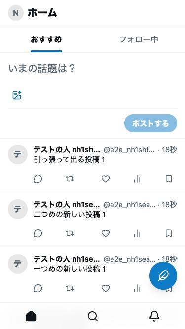
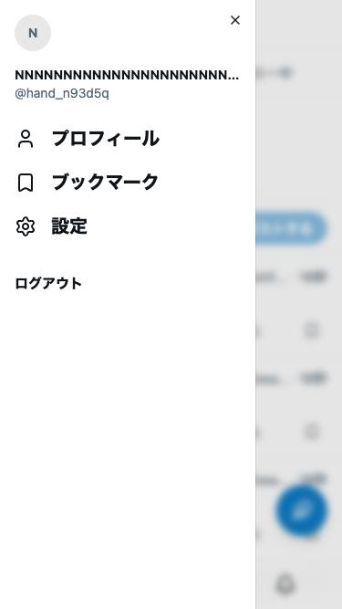
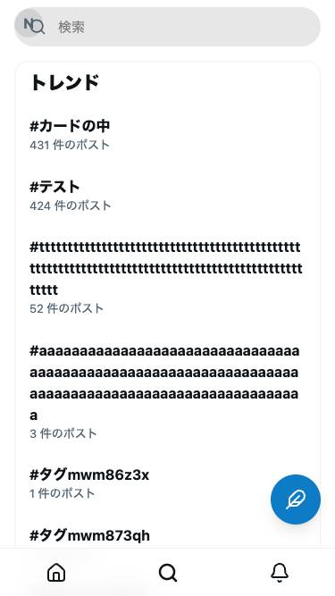
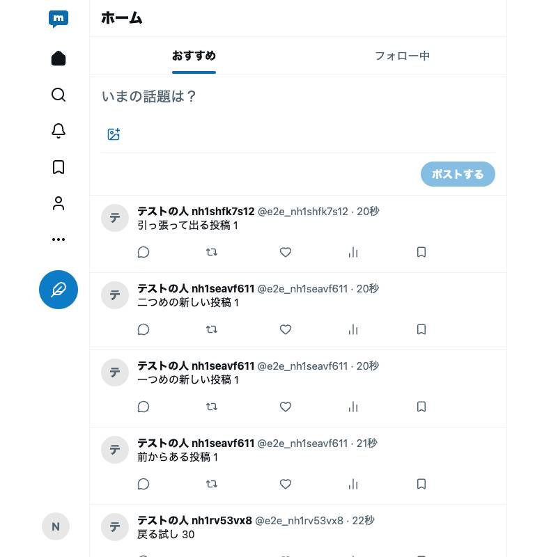
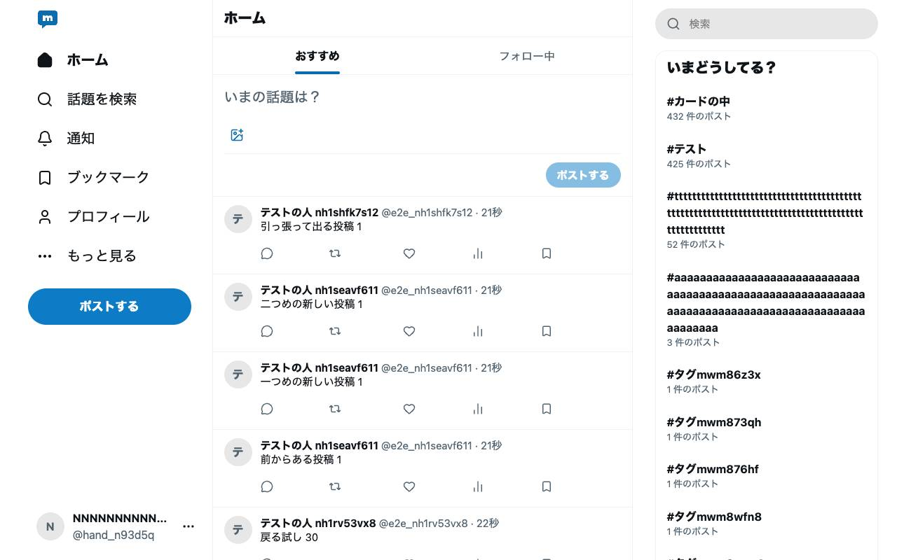

# 試験レポート: 640px より狭い画面で、ログアウトも、自分のプロフィール・ブックマーク・設定へも行けない

## 対象

- issue: [#85](https://github.com/ohta-rh/x-modoki-v2/issues/85)（バグ。#34 の探索的テストの 5 巡目で見つけた）
- commit: `601bbd4`、レビューの指摘を直した `a7ef133`・`783b885`（ブランチ `m1/local-app`、PR #40）
- CI: [実行 44519237143](https://github.com/ohta-rh/x-modoki-v2/actions/runs/44519237143)（成功）
- 日付: 2026-11-19

## 環境

- macOS 26.2、Google Chrome（拡張から操作、と Playwright 1.65.0 の `channel: 'chrome'`）、Node.js 26.12.0（`.nvmrc` は 24。CI の実行を本当の結果とする）、Docker Compose の PostgreSQL
- 動かし方: `pnpm build && pnpm start -p 3001`。Chrome の確認用の架空の人（`chrome_check18`、テーマ dim）と、確かめるために登録した架空の人（`hand_n93d5q`、ライト）

## 判定

合格 — 受け入れ条件 6 件のうち 6 件を満たした。

## 受け入れ条件ごとの結果

| # | 条件 | 確かめ方 | 結果 | エビデンス |
|---|---|---|---|---|
| 1 | 640px 未満では、ヘッダーの左のアバターのボタンで、左から引き出しが開く | `e2e/narrow.spec.ts` › 640px 未満でも、ヘッダーのアバターの引き出しから…（#85）、`mobile-account-drawer.test.tsx` | 合格 | テストの名前のとおり |
| 2 | 引き出しにアバター・名前・@・プロフィール・ブックマーク・設定・ログアウト。リンクで移って閉じる。ログアウトは `/`、オフラインはトースト | 同上 | 合格 | テストの名前のとおり |
| 3 | Esc と外のクリックで閉じ、フォーカスを中に閉じ、閉じたらボタンへ戻す | 同上（外のクリック、Tab を 8 回、Esc のあとのフォーカス） | 合格 | テストの名前のとおり |
| 4 | 640px 以上では出ない | `app-shell.test.tsx`（`sm:hidden`）、`e2e/auth.spec.ts`（大きい画面でボタンが 1 つ） | 合格 | テストの名前のとおり |
| 5 | ログインしていなければ出ない | `app-shell.test.tsx` › ログインしていれば… | 合格 | テストの名前のとおり |
| 6 | CI が緑で、カバレッジが 100% のまま | CI の実行 | 合格 | CI の実行 |

## 自動のテスト

`PORT=3300 pnpm verify` が 0 で終わった（`783b885`）: 単体のテスト 186 ファイル 1089 本、カバレッジ 4 つとも 100%、画面のテスト 375 本（Chromium・Firefox・WebKit）。CI でも同じ 7 つが通った。

### TDD の記録

| # | 振る舞い | 先に書いたテスト | 赤（落ちた理由） | 緑にした実装 |
|---|---|---|---|---|
| 1 | 引き出しから全部へ行ける（受け入れのテスト） | `e2e/narrow.spec.ts` › 640px 未満でも… | `locator.click: … waiting for getByRole('button', { name: /のアカウントのメニュー$/ })`（ボタンが無い） | `mobile-account-drawer.tsx`・`app-shell.tsx` |
| 2 | アバターのボタンと引き出しの中身・リンク・ログアウト | `mobile-account-drawer.test.tsx` の 3 本 | 空の部品で `Unable to find an accessible element with the role "button"` | `mobile-account-drawer.tsx` |
| 3 | ログインしているときだけ出し、見出しが余白を取る | `app-shell.test.tsx`・`page-header.test.tsx` | `expect(element).toHaveClass("pl-14 sm:pl-4")` など | `app-shell.tsx`・`page-header.tsx` |
| 4 | 探す画面の欄がアバターに重ならない（レビュー 1） | e2e の重なりの確かめ、`explore-page.test.tsx`・`search-page.test.tsx` | `/explore` `Expected: false` `Received: true` | `explore-page.tsx`・`search-page.tsx` |
| 5 | ログインしていなければ余白も取らない（レビュー 2） | `page-header.test.tsx`・`app-shell.test.tsx`・e2e | `expect(element).toHaveClass("px-4 group-data-signed-in/shell:pl-14 …")` | `page-header.tsx`・`app-shell.tsx`（`group/shell`） |

## コードレビュー

- 判定: APPROVE（2 回目、#85・#86 をまとめて）　範囲: 1 回目 `origin/m1/local-app...601bbd4`、2 回目 `…a7ef133`　レビューした sub agent: code-reviewer（opus）

| # | 回 | 重さ | 指摘 | 確かめた結果 | 対応 |
|---|---|---|---|---|---|
| 1 | 1 | major | 話題を検索と検索の画面は PageHeader を使わないので、アバターが検索の欄の左の端に重なる | 再現した（375px で重なりが true。`review-explore-overlap-375.jpg`） | 直した（`a7ef133`）。欄に `pl-10 sm:pl-0`。e2e で重ならないことを確かめる |
| 2 | 1 | major | Shift+Tab で戻るときの上の見出しの確かめが無い。/home は見出しとタブで 107px あり、53px の余白では隠れる | 再現した（Shift+Tab で一覧の操作が y=53〜87、タブの下に完全に隠れる） | 直した（`a7ef133`）。背の高い固定の部分に印を付け、その画面だけ上の余白を 116px。e2e を足した |
| 3 | 1 | major | 引き出しの外のクリックと、フォーカスの閉じ込めのテストが無い | 正しい（作りは Base UI で効いていた） | 直した（`a7ef133`）。e2e を足した。閉じ込めは、端で Base UI の番人を通るので、戻るのを待つ形 |
| 4 | 2 | minor | ログインしていない人の見出しにも、アバターの分の空きができる | 再現した（公開のプロフィール） | 直した（`783b885`）。ログインしているときだけ余白を取る。e2e と単体のテストを足した |

## ブラウザでの確認

| URL | 幅 | テーマ | した操作 | 見えた結果 | 画面の写真 |
|---|---|---|---|---|---|
| `/home` | 375 | ライト | 開いた | ヘッダーの左にアバター | `85-home-375.jpg` |
| `/home` | 375 | ライト | アバターを押した | 左から引き出し。名前は切り詰め、プロフィール・ブックマーク・設定・ログアウト | `85-drawer-375.jpg` |
| `/explore（レビュー 1 の前）` | 375 | ライト | 開いた | アバターが検索の欄の左に重なる | `review-explore-overlap-375.jpg` |
| `/home` | 768 | ライト | 開いた | アバターは出ない（左の列のメニュー） | `85-home-768.jpg` |
| `/home` | 1280 | ライト | 開いた | 同じ | `85-home-1280.jpg` |

- コンソール: エラー 0、警告 0　通信: 失敗 0（`chrome-evidence.mjs` の読み込みと、Playwright の Chrome での操作。わざと通信を切った間の失敗と、壊れた URL の 404 は除く）
- 1400px の写真は、拡張から操作した Chrome の窓の幅

## 見つけた問題

なし
