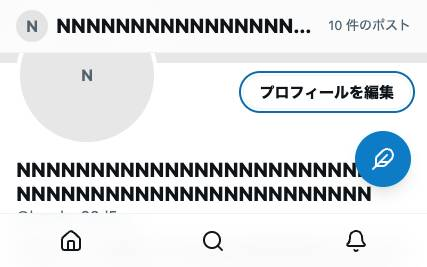
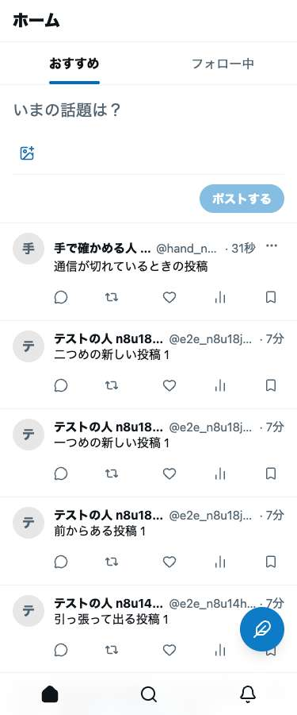

# 試験レポート: 狭く低い画面で、Tab で動いたフォーカスが下のタブバーや丸い投稿ボタンの下に隠れる

## 対象

- issue: [#86](https://github.com/ohta-rh/x-modoki-v2/issues/86)（バグ。#34 の探索的テストの 5 巡目で見つけた）
- commit: `601bbd4`、レビューの指摘を直した `a7ef133`（ブランチ `m1/local-app`、PR #40）
- CI: [実行 44519237143](https://github.com/ohta-rh/x-modoki-v2/actions/runs/44519237143)（成功）
- 日付: 2026-11-19

## 環境

- macOS 26.2、Google Chrome（拡張から操作、と Playwright 1.65.0 の `channel: 'chrome'`）、Node.js 26.12.0（`.nvmrc` は 24。CI の実行を本当の結果とする）、Docker Compose の PostgreSQL
- 動かし方: `pnpm build && pnpm start -p 3001`。Chrome の確認用の架空の人（`chrome_check18`、テーマ dim）と、確かめるために登録した架空の人（`hand_n93d5q`、ライト）

## 判定

合格 — 受け入れ条件 3 件のうち 3 件を満たした。

## 受け入れ条件ごとの結果

| # | 条件 | 確かめ方 | 結果 | エビデンス |
|---|---|---|---|---|
| 1 | 640px 未満で Tab を進めると、フォーカスした要素は下のタブバーと丸い投稿ボタンに隠れない | `e2e/narrow.spec.ts` › 狭く低い画面でも、Tab のフォーカスは…（#86）、› Shift+Tab で戻っても…360×300 の「いいね」も… | 合格 | テストの名前のとおり |
| 2 | 上に固定の見出しの下にも隠れない（Shift+Tab） | 同 › Shift+Tab で戻っても…（/home の 375×400・1280×500、プロフィールの 375×400） | 合格 | テストの名前のとおり |
| 3 | CI が緑で、カバレッジが 100% のまま | CI の実行 | 合格 | CI の実行 |

## 自動のテスト

`PORT=3300 pnpm verify` が 0 で終わった（`783b885`）: 単体のテスト 186 ファイル 1089 本、カバレッジ 4 つとも 100%、画面のテスト 375 本（Chromium・Firefox・WebKit）。CI でも同じ 7 つが通った。

### TDD の記録

| # | 振る舞い | 先に書いたテスト | 赤（落ちた理由） | 緑にした実装 |
|---|---|---|---|---|
| 1 | プロフィールを編集がタブバーの下に隠れない（受け入れのテスト） | `e2e/narrow.spec.ts` › 狭く低い画面でも… | `above the tab bar` `Expected: <= 214` `Received: 241.33` | `global.css`（`scroll-padding`） |
| 2 | Shift+Tab で見出しとタブの下に隠れない（レビュー 1） | 同 › Shift+Tab で戻っても… | `/home?tab=following at 375×400` `Expected: >= 106` `Received: 77`。WCAG の「完全に隠れない」に合わせて、下端が固定の部分より下にあるかで判定する形にした（320×300 では収まる高さが 48px しかなく、厳しすぎた） | `global.css`（`html:has(main [data-tall-sticky])` で 116px）、`home-page.tsx`・`search-page.tsx` の印 |
| 3 | 背の高い固定の部分の印 | `home-page.test.tsx`・`search-page.test.tsx` | `expected null not to be null` | `data-tall-sticky` |

## コードレビュー

- 判定: APPROVE（2 回目、#85・#86 をまとめて）　範囲: 1 回目 `origin/m1/local-app...601bbd4`、2 回目 `…a7ef133`　レビューした sub agent: code-reviewer（opus）

| # | 回 | 重さ | 指摘 | 確かめた結果 | 対応 |
|---|---|---|---|---|---|
| 1 | 1 | major | 話題を検索と検索の画面は PageHeader を使わないので、アバターが検索の欄の左の端に重なる | 再現した（375px で重なりが true。`review-explore-overlap-375.jpg`） | 直した（`a7ef133`）。欄に `pl-10 sm:pl-0`。e2e で重ならないことを確かめる |
| 2 | 1 | major | Shift+Tab で戻るときの上の見出しの確かめが無い。/home は見出しとタブで 107px あり、53px の余白では隠れる | 再現した（Shift+Tab で一覧の操作が y=53〜87、タブの下に完全に隠れる） | 直した（`a7ef133`）。背の高い固定の部分に印を付け、その画面だけ上の余白を 116px。e2e を足した |
| 3 | 1 | major | 引き出しの外のクリックと、フォーカスの閉じ込めのテストが無い | 正しい（作りは Base UI で効いていた） | 直した（`a7ef133`）。e2e を足した。閉じ込めは、端で Base UI の番人を通るので、戻るのを待つ形 |
| 4 | 2 | minor | ログインしていない人の見出しにも、アバターの分の空きができる | 再現した（公開のプロフィール） | 直した（`783b885`）。ログインしているときだけ余白を取る。e2e と単体のテストを足した |

## ブラウザでの確認

| URL | 幅 | テーマ | した操作 | 見えた結果 | 画面の写真 |
|---|---|---|---|---|---|
| `/hand_n93d5q` | 427 | ライト | 427×267 で Tab を進めて「プロフィールを編集」へ | タブバー（上端 214）より上の 109 まで送られて見える | `86-focus-427x267.jpg` |
| `/home` | 768 | ライト | 開いた（変えていない隣の画面） | 崩れない、横にはみ出さない | `home-768.jpg` |
| `/home` | 375 | ライト | 開いた（変えていない隣の画面） | 崩れない、横にはみ出さない | `home-375.jpg` |

- コンソール: エラー 0、警告 0　通信: 失敗 0（`chrome-evidence.mjs` の読み込みと、Playwright の Chrome での操作。わざと通信を切った間の失敗と、壊れた URL の 404 は除く）
- 1400px の写真は、拡張から操作した Chrome の窓の幅

## 見つけた問題

1. 全部の確認で、`e2e/reactions.spec.ts` › 詳細を開くと表示の回数が数えられ、カードに出る が WebKit で 1 回落ちた。詳細を描いたあとに送る表示の要求より先にテストがホームへ移ると、数えられないまま 0 になる（WebKit の描くのが遅いとき）。テストの競り合いなので、表示の要求の応答を待ってから移る形にし（`a7ef133`）、3 つのブラウザで 5 回ずつ通した
