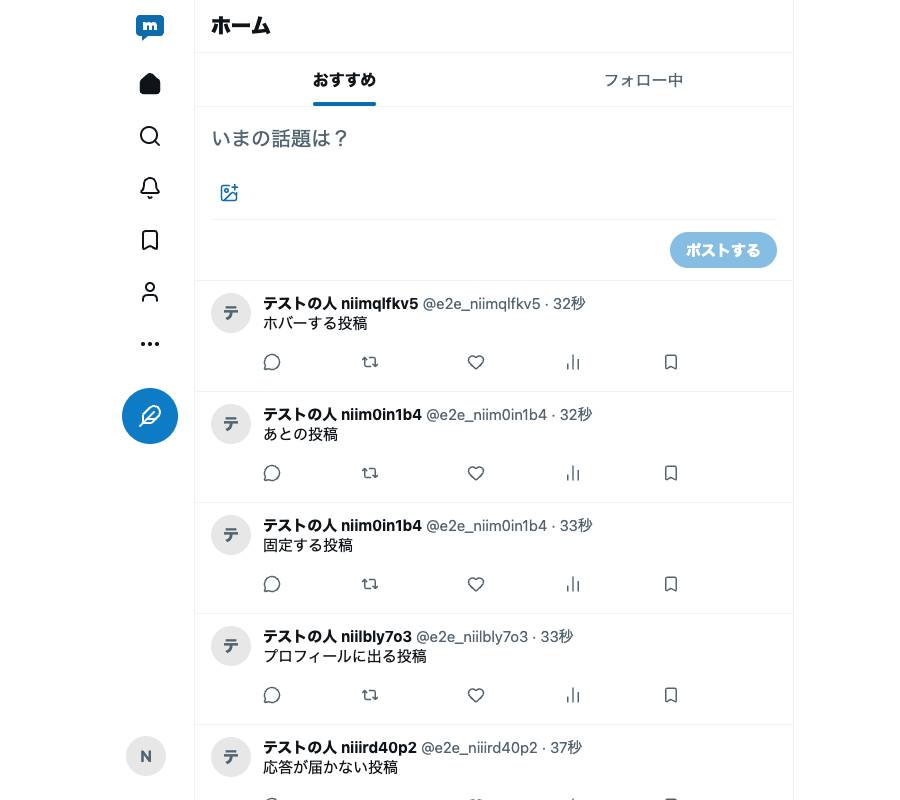

# 試験レポート: アカウントの引き出しを開いたまま画面を 640px より広げると、引き出しが残り、閉じてもフォーカスの行き場が無い

## 対象

- issue: [#87](https://github.com/ohta-rh/x-modoki-v2/issues/87)（バグ。#34 の探索的テストの 6 巡目で見つけた）
- commit: `819ea36`、7 巡目で見つけた残り（フォーカス）を直した `34feaa0`（ブランチ `m1/local-app`、PR #40）
- CI: [実行 44527846268](https://github.com/ohta-rh/x-modoki-v2/actions/runs/44527846268)（成功）
- 日付: 2026-11-19

## 環境

- macOS 26.2、Google Chrome（拡張から操作、と Playwright 1.65.0 の `channel: 'chrome'`）、Node.js 26.12.0（`.nvmrc` は 24。CI の実行を本当の結果とする）、Docker Compose の PostgreSQL
- 動かし方: `pnpm build && pnpm start -p 3001`。Chrome の確認用の架空の人（`chrome_check18`、テーマ dim）と、確かめるために登録した架空の人（`hand_n93d5q`、ライト）

## 判定

合格 — 受け入れ条件 4 件のうち 4 件を満たした。

## 受け入れ条件ごとの結果

| # | 条件 | 確かめ方 | 結果 | エビデンス |
|---|---|---|---|---|
| 1 | 引き出しを開いたまま 640px 以上に広げると、引き出しは閉じる | `e2e/narrow.spec.ts` › 引き出しを開いたまま 640px より広げると閉じる（#87）、`mobile-account-drawer.test.tsx` | 合格 | テストの名前のとおり |
| 2 | 640px 未満のままの幅の変化では閉じない | `mobile-account-drawer.test.tsx` › 開いたまま 640px 以上になると閉じ… | 合格 | テストの名前のとおり |
| 3 | （題にある）閉じたあとのフォーカスが行き場を失わない。左の列のアカウントのメニューへ移る | `e2e/narrow.spec.ts` › 引き出しを開いたまま 640px より広げると閉じる（#87）、`mobile-account-drawer.test.tsx` › 640px 以上になって閉じたら… | 合格 | テストの名前のとおり |
| 4 | CI が緑で、カバレッジが 100% のまま | CI の実行 | 合格 | CI の実行 |

## 自動のテスト

`PORT=3300 pnpm verify` が 0 で終わった（`819ea36`）: 単体のテスト 186 ファイル 1092 本、カバレッジ 4 つとも 100%、画面のテスト 381 本（Chromium・Firefox・WebKit）。CI でも同じ 7 つが通った。

- その前の 1 回で、WebKit の登録が 5 秒を超えて止まった（`e2e/follow.spec.ts`、続く 7 本が打ち切り）。WebKit のコンテナのゾンビは 0 で、#84 で直したものとは別。流し直すと全部通った。原因は分からない。手元で 3 つのブラウザを 8 つずつ並べて流すときだけに起き、CI では起きていない

### TDD の記録

| # | 振る舞い | 先に書いたテスト | 赤（落ちた理由） | 緑にした実装 |
|---|---|---|---|---|
| 1 | 広げると閉じる（受け入れのテスト） | `e2e/narrow.spec.ts` › 引き出しを開いたまま 640px より広げると閉じる | `getByRole('dialog', { name: 'アカウント' })` `Expected: 0` `Received: 1` | `mobile-account-drawer.tsx` |
| 2 | 640px 以上の知らせで閉じ、未満では閉じない | `mobile-account-drawer.test.tsx` › 開いたまま 640px 以上になると閉じ… | `expected 
 to be null`。直したあと、ほかの 3 本が `window.matchMedia is not a function`（jsdom に無い）で落ちたので、まねる所をファイルの先頭に移した（テストの誤り） | `mobile-account-drawer.tsx`（`matchMedia('(min-width: 640px)')`） |
| 3 | 閉じたらフォーカスを左の列のメニューへ（7 巡目） | `mobile-account-drawer.test.tsx` › 640px 以上になって閉じたら…、e2e の `toBeFocused` | `Expected element with focus` / e2e `Expected: focused` `Received: inactive`。直したあと、後片付けの順で `matchMedia` が無くなって落ちたので、まねを外す `afterEach` をやめた（テストの誤り） | `mobile-account-drawer.tsx`（`finalFocus`）、`account-menu.tsx`（`data-account-menu`） |

## コードレビュー

- 判定: APPROVE（1 回目、#87・#88 をまとめて）　範囲: `origin/m1/local-app...819ea36`　レビューした sub agent: code-reviewer（opus）

| # | 重さ | 指摘 | 確かめた結果 | 対応 |
|---|---|---|---|---|
| — | — | 指摘なし（別の欄の画像・置き換えた画像・他人の画像・空の欄を断ること、取り込みの同時の競り合いを、取引の中の `pending` の確かめが守ることも確かめた） | — | — |

## ブラウザでの確認

| URL | 幅 | テーマ | した操作 | 見えた結果 | 画面の写真 |
|---|---|---|---|---|---|
| `/home` | 900 | ライト | 375px で引き出しを開いてから 900px に広げた | 引き出しは閉じ、左の列がいつも通り出る | `87-widened-900.jpg` |
| `/home` | 768 | ライト | 開いた（変えていない隣の画面） | 崩れない、横にはみ出さない | `home-768.jpg` |
| `/home` | 375 | ライト | 開いた（変えていない隣の画面） | 崩れない、横にはみ出さない | `home-375.jpg` |

- コンソール: エラー 0、警告 0　通信: 失敗 0（`chrome-evidence.mjs` の読み込みと、Playwright の Chrome での操作。わざと通信を切った間の失敗と、壊れた URL の 404 は除く）
- 1400px の写真は、拡張から操作した Chrome の窓の幅

## 見つけた問題

1. 7 巡目の探索的テストで、広げて閉じたあとのフォーカスが `BODY` に落ちることが残っていた（題に書いたのに受け入れ条件に入れ損ねた）。この PBI の中で直した（`34feaa0`）
2. `819ea36` の CI が赤。#74 と #80 の全部の画面を回るテストが、保存のあとの移動とフォローのあとの読み直しの途中で次の `goto` をして、WebKit で割り込まれた。プロフィールに着くのと、読み直しの応答の中身を読み終わるのを待つ形にし（`34feaa0`）、3 つのブラウザで 4 回ずつ通した
