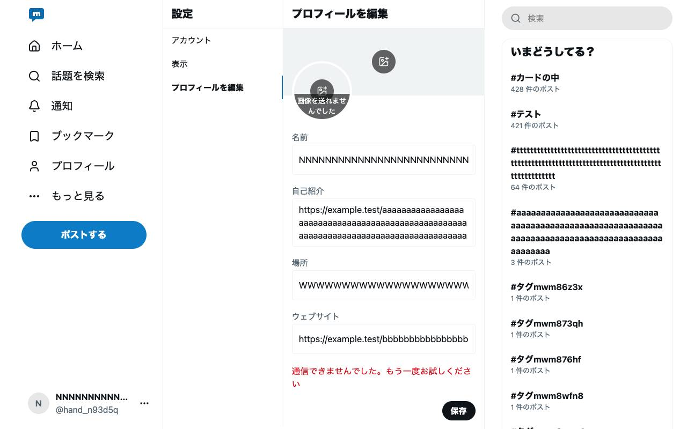
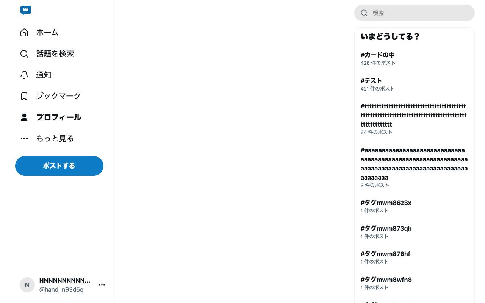

# 試験レポート: プロフィールの画像の保存の応答が届かずにやり直すと「画像を保存できませんでした」になる

## 対象

- issue: [#88](https://github.com/ohta-rh/x-modoki-v2/issues/88)（バグ。#34 の探索的テストの 6 巡目で見つけた）
- commit: `819ea36`（ブランチ `m1/local-app`、PR #40）
- CI: [実行 44527846268](https://github.com/ohta-rh/x-modoki-v2/actions/runs/44527846268)（成功）
- 日付: 2026-11-19

## 環境

- macOS 26.2、Google Chrome（拡張から操作、と Playwright 1.65.0 の `channel: 'chrome'`）、Node.js 26.12.0（`.nvmrc` は 24。CI の実行を本当の結果とする）、Docker Compose の PostgreSQL
- 動かし方: `pnpm build && pnpm start -p 3001`。Chrome の確認用の架空の人（`chrome_check18`、テーマ dim）と、確かめるために登録した架空の人（`hand_n93d5q`、ライト）

## 判定

合格 — 受け入れ条件 4 件のうち 4 件を満たした。

## 受け入れ条件ごとの結果

| # | 条件 | 確かめ方 | 結果 | エビデンス |
|---|---|---|---|---|
| 1 | もう取り込んだ同じ画像の ID でもう一度保存すると、画像は変えずにほかの欄を保存して成功 | `update-profile.test.ts` › もう取り込んだ自分のアバター・バナーの同じ ID で…（#88） | 合格 | テストの名前のとおり |
| 2 | 他人の画像・使われていない画像・別の欄の画像は断る | `update-profile.test.ts` › 取り込み済みでも、自分の別の欄の画像…（#88）、既存の FORBIDDEN のテスト | 合格 | テストの名前のとおり |
| 3 | 応答が失われた保存をやり直すと、プロフィールへ移る | `e2e/profile-images.spec.ts` › プロフィールの画像の保存の応答が届かずにやり直しても、保存できる（#88）（issue の `e2e/offline.spec.ts` ではなく、画像の spec に置いた） | 合格 | テストの名前のとおり |
| 4 | CI が緑で、カバレッジが 100% のまま | CI の実行 | 合格 | CI の実行 |

## 自動のテスト

`PORT=3300 pnpm verify` が 0 で終わった（`819ea36`）: 単体のテスト 186 ファイル 1092 本、カバレッジ 4 つとも 100%、画面のテスト 381 本（Chromium・Firefox・WebKit）。CI でも同じ 7 つが通った。

- その前の 1 回で、WebKit の登録が 5 秒を超えて止まった（`e2e/follow.spec.ts`、続く 7 本が打ち切り）。WebKit のコンテナのゾンビは 0 で、#84 で直したものとは別。流し直すと全部通った。原因は分からない。手元で 3 つのブラウザを 8 つずつ並べて流すときだけに起き、CI では起きていない

### TDD の記録

| # | 振る舞い | 先に書いたテスト | 赤（落ちた理由） | 緑にした実装 |
|---|---|---|---|---|
| 1 | やり直すとプロフィールへ（受け入れのテスト） | `e2e/profile-images.spec.ts` › プロフィールの画像の保存の応答が届かずに… | `Expected pattern: /\/e2e_…$/` `Received string: "http://localhost:3300/settings/profile"` | `update-profile.ts` |
| 2 | 取り込み済みの同じ画像は外して成功 | `update-profile.test.ts` › もう取り込んだ自分のアバター・バナーの… | `expected { ok: false, code: 'VALIDATION', … } to deeply equal { ok: true }` | `update-profile.ts`（この人の今の欄と同じ `key` の ready の画像を外す） |
| 3 | 断る場合（見張り） | 同 › 取り込み済みでも、自分の別の欄の画像… | 今の作りで通る（直したあとも通ることの見張り） | 変更なし |

## コードレビュー

- 判定: APPROVE（1 回目、#87・#88 をまとめて）　範囲: `origin/m1/local-app...819ea36`　レビューした sub agent: code-reviewer（opus）

| # | 重さ | 指摘 | 確かめた結果 | 対応 |
|---|---|---|---|---|
| — | — | 指摘なし（別の欄の画像・置き換えた画像・他人の画像・空の欄を断ること、取り込みの同時の競り合いを、取引の中の `pending` の確かめが守ることも確かめた） | — | — |

## ブラウザでの確認

| URL | 幅 | テーマ | した操作 | 見えた結果 | 画面の写真 |
|---|---|---|---|---|---|
| `/settings/profile` | 1280 | ライト | 新しいアバターを選び、保存の応答だけを切った | 通信の文言（画像はもう保存済み） | `88-first-cut-1280.jpg` |
| `/hand_n93d5q` | 1280 | ライト | もう一度「保存」 | プロフィールへ移り、新しいアバター | `88-after-retry-1280.jpg` |
| `/home` | 768 | ライト | 開いた（変えていない隣の画面） | 崩れない、横にはみ出さない | `home-768.jpg` |
| `/home` | 375 | ライト | 開いた（変えていない隣の画面） | 崩れない、横にはみ出さない | `home-375.jpg` |

- コンソール: エラー 0、警告 0　通信: 失敗 0（`chrome-evidence.mjs` の読み込みと、Playwright の Chrome での操作。わざと通信を切った間の失敗と、壊れた URL の 404 は除く）
- 1400px の写真は、拡張から操作した Chrome の窓の幅

## 見つけた問題

なし
