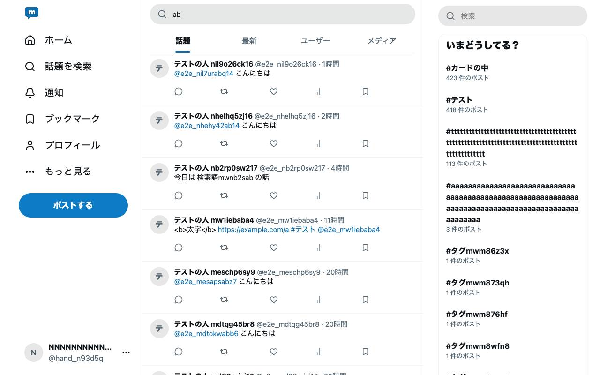
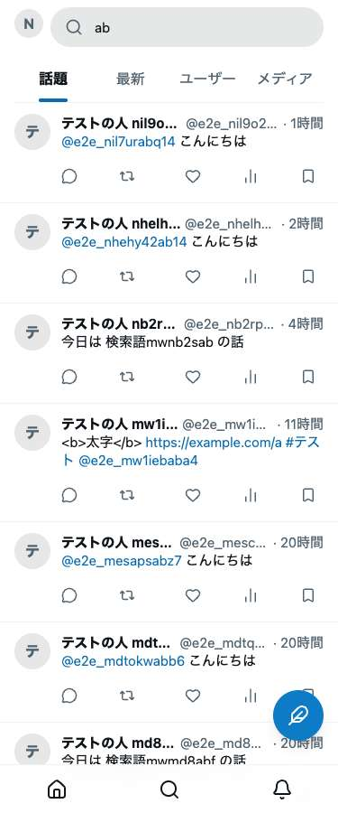
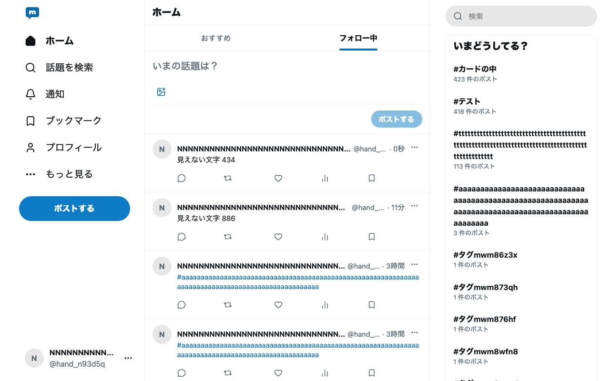
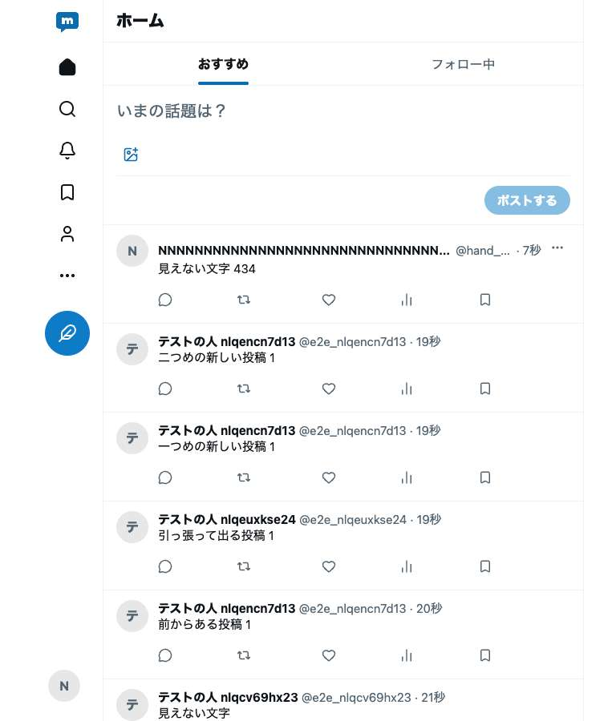
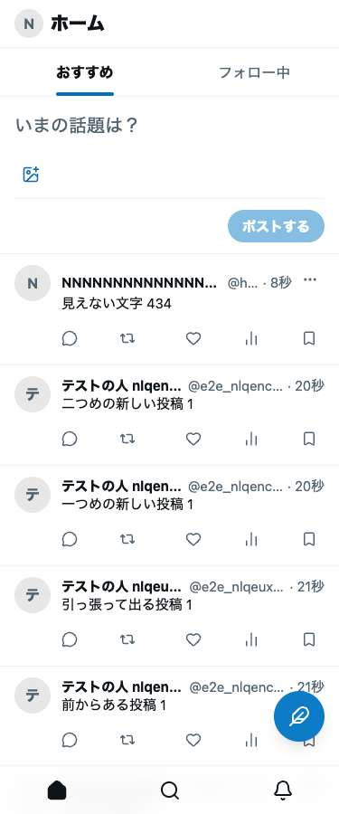

# 試験レポート: U+0000（NUL）を含む検索・投稿・返信・自己紹介・名前で、誤りの画面か「通信できませんでした」になる

## 対象

- issue: [#89](https://github.com/ohta-rh/x-modoki-v2/issues/89)（バグ。#34 の探索的テストの 8 巡目で見つけた）
- commit: `5ce904b`、レビューで直した `20c0f72`・`3ebfa2e`（ブランチ `m1/local-app`、PR #40）
- CI: [実行 44537584475](https://github.com/ohta-rh/x-modoki-v2/actions/runs/44537584475)（成功）
- 日付: 2026-11-19

## 環境

- macOS 26.2、Google Chrome（Playwright 1.65.0 の `channel: 'chrome'`）、Node.js 26.12.0（`.nvmrc` は 24。CI の実行を本当の結果とする）、Docker Compose の PostgreSQL
- 動かし方: `pnpm build && pnpm start -p 3001`。確かめるために登録した架空の人（`hand_n93d5q`、ライト）

## 判定

合格 — 受け入れ条件 4 件のうち 4 件を満たした。

## 受け入れ条件ごとの結果

| # | 条件 | 確かめ方 | 結果 | エビデンス |
|---|---|---|---|---|
| 1 | 人が入れた文字を整える関数を 1 つ（`cleanText`）にし、検索の語・投稿の本文と重み・プロフィール・登録の名前・ログインの識別子が使う（レビューで画像の代替テキストも） | `clean-text.test.ts`、`search-query.test.ts`・`measure-post.test.ts`・2 つの `schema.test.ts` › U+0000 は除く… | 合格 | テストの名前のとおり |
| 2 | `/search?q=%00` と `a%00b` は普通の検索の結果 | `e2e/search.spec.ts` › U+0000 を含む検索の語でも、誤りの画面にならない…（#89）（`%00` だけは空の語なので、ほかの空の検索と同じ「話題を検索」） | 合格 | テストの名前のとおり |
| 3 | U+0000 を含む投稿・返信・自己紹介は、U+0000 を除いて保存される | `create-post.test.ts` › U+0000 は除いて保存する（返信も同じ関数）、`update-profile.test.ts` › U+0000 を含む自己紹介は…、`e2e/search.spec.ts`（投稿） | 合格 | テストの名前のとおり |
| 4 | CI が緑で、カバレッジが 100% のまま | CI の実行 | 合格 | CI の実行 |

## 自動のテスト

`PORT=3300 pnpm verify` が 0 で終わった（`3ebfa2e`）: 単体のテスト 187 ファイル 1105 本、カバレッジ 4 つとも 100%、画面のテスト 387 本（Chromium・Firefox・WebKit）。CI でも同じ 7 つが通った。

- `20c0f72` の前の 1 回で、WebKit の画像のビューアのテストが 1 本落ちた（触っていない所。単独で 5 回ずつ流すと 20 本とも通る）。手元で 3 つのブラウザを並べて流すときだけに起きる遅さで、原因は分からない。CI では起きていない
- `5ce904b` の前の 1 回で、オフラインのログアウトのテスト（#82）が、メニューを開いてすぐ通信を切るので、あとから読み込むメニュー（ADR-0059）が出ずに落ちた。メニューが出るのを待ってから切る形にした（テストの誤り、3 回ずつ通した）

### TDD の記録

| # | 振る舞い | 先に書いたテスト | 赤（落ちた理由） | 緑にした実装 |
|---|---|---|---|---|
| 1 | NUL の検索で誤りの画面にならない（受け入れのテスト） | `e2e/search.spec.ts` › U+0000 を含む検索の語でも… | `Expected substring: "の検索結果"` `Received string: "問題が起きました"`（サーバーに `invalid byte sequence for encoding "UTF8": 0x00`） | `search-query.ts`（`cleanText`） |
| 2 | `cleanText` が U+0000 を除き、NFC、前後を削る | `clean-text.test.ts` | `expected '  が\u0000な\n\n ' to be 'がな'`（何もしない仮の関数） | `src/shared/lib/text/clean-text.ts` |
| 3 | 検索の語・プロフィール・登録とログインから除く | `search-query.test.ts`・`profile-edit/model/schema.test.ts`・`account-access/model/schema.test.ts` › …U+0000…（#89） | `expected 'a\u0000b' to be 'ab'`、`expected '猫\u0000が好き' to be '猫が好き'`、`expected '花\u0000子' to be '花子'` | 各ファイルで `cleanText` / `.overwrite(cleanText)` |
| 4 | 投稿から除いて保存 | `create-post.test.ts` › U+0000 は除いて保存する | PostgreSQL の `22021`（`invalid byte sequence`、60 秒の重複の確かめの問い合わせ） | `create-post.ts`（`cleanText`） |
| 5 | 重みに数えない | `measure-post.test.ts` › U+0000 は保存しないので、重みに数えない | `expected 4 to be 3`（前の数え方に戻して確かめた） | `measure-post.ts` |
| 6 | 画像の代替テキストからも除く（レビュー 1） | `create-post.test.ts` › 画像の代替テキストからも U+0000 を除き… | PostgreSQL の `22021`（`update "media" set … "alt"`） | `create-post.ts`（始めで代替テキストを整える） |
| 7 | 自己紹介を本物の PostgreSQL で除いて保存（レビュー 4） | `update-profile.test.ts` › U+0000 を含む自己紹介は… | スキーマを前の形に戻すと `22021`（`update "users" set …`） | 変更なし（`profileSchema` の `cleanText`） |

## コードレビュー

- 判定: APPROVE（2 回目、#89・#90 をまとめて）　範囲: `origin/m1/local-app...20c0f72`（1 回目は `...5ce904b`）　レビューした sub agent: code-reviewer（opus）

| # | 重さ | 指摘 | 確かめた結果 | 対応 |
|---|---|---|---|---|
| 1 | major（1 回目） | 画像の代替テキストは人が入れる文字なのに `cleanText` を通らず、`a\u0000b` の代替テキストで `media.alt` の更新が PostgreSQL に断られ、やり直しても通らない（`create-post.ts:177`） | 再現した（`create-post.test.ts` で 22021） | 直した（`20c0f72`）。`createPost` の始めで代替テキストを整える。テスト: `create-post.test.ts` › 画像の代替テキストからも U+0000 を除き… |
| 2 | minor（1 回目） | 送っている途中で外した画像の失敗があとから届くと、0 枚なのに文言が出る（`image-attachments.tsx:39-42`） | 再現した（単体のテスト） | 直した（`20c0f72`）。文言を「送れなかった画像があるか」から導く。テスト: `image-attachments.test.tsx` › 送っている途中で外した画像の失敗が… |
| 3 | minor（2 回目） | 5 枚選んで「4 枚まで」が出たあとに送れないと、「画像を送れませんでした」が出ない（`image-attachments.tsx:54`、指摘 2 の直し方が生んだ） | 再現した（単体のテスト） | 直した（`3ebfa2e`）。提案のとおり送れなかった方を先に出す。テスト: 同 › 5 枚選んで「4 枚まで」と出たあとでも… |
| 4 | minor（2 回目） | 受け入れ条件の自己紹介の確かめが Zod のスキーマだけで、本物の PostgreSQL での保存のテストが無い | そのとおり（今の失敗は無い） | 足した（`3ebfa2e`）。`update-profile.test.ts` › U+0000 を含む自己紹介は…。スキーマを前の形に戻すと 22021 で落ちることを見た |

## ブラウザでの確認

| URL | 幅 | テーマ | した操作 | 見えた結果 | 画面の写真 |
|---|---|---|---|---|---|
| `/search?q=a%00b` | 1280 | ライト | U+0000 を含む語で検索 | 「「ab」の検索結果」。誤りの画面にならない | `89-search-1280.jpg` |
| `/search?q=a%00b` | 375 | ライト | 同じ | 崩れない | `search-375.jpg` |
| `/home` | 1280 | ライト | 「見えない\u0000文字」を投稿 | 「見えない文字」で載る | `89-post-1280.jpg` |
| `/home` | 768 | ライト | 開いた（変えていない隣の画面） | 崩れない、横にはみ出さない | `home-768.jpg` |
| `/home` | 375 | ライト | 開いた（変えていない隣の画面） | 崩れない、横にはみ出さない | `home-375.jpg` |

- コンソール: エラー 0、警告 0　通信: 失敗 0（`chrome-evidence.mjs` の読み込みと、Playwright の Chrome での操作。わざと止めた画像の送信の失敗は除く）

## 見つけた問題

1. 8 巡目の探索的テストで、U+0000 を含む検索・投稿・返信・自己紹介が誤りになると分かった（この PBI）。人が入れた文字の整え方の漏れは #66・#67 に続く 3 回目なので、`.claude/rules/architecture-fsd.md` に「人が入れた文字は `cleanText` を通す」を書いた
2. レビューで、画像の代替テキストが同じ形で漏れていた（直した）
3. オフラインのログアウトの e2e が、あとから読み込むメニューの前に通信を切っていた（テストの誤り。直した）
4. URL の道の `/%00`・`/x/status/1%00` などは「このページは存在しません」になり、問題が無いことを 3001 で確かめた
