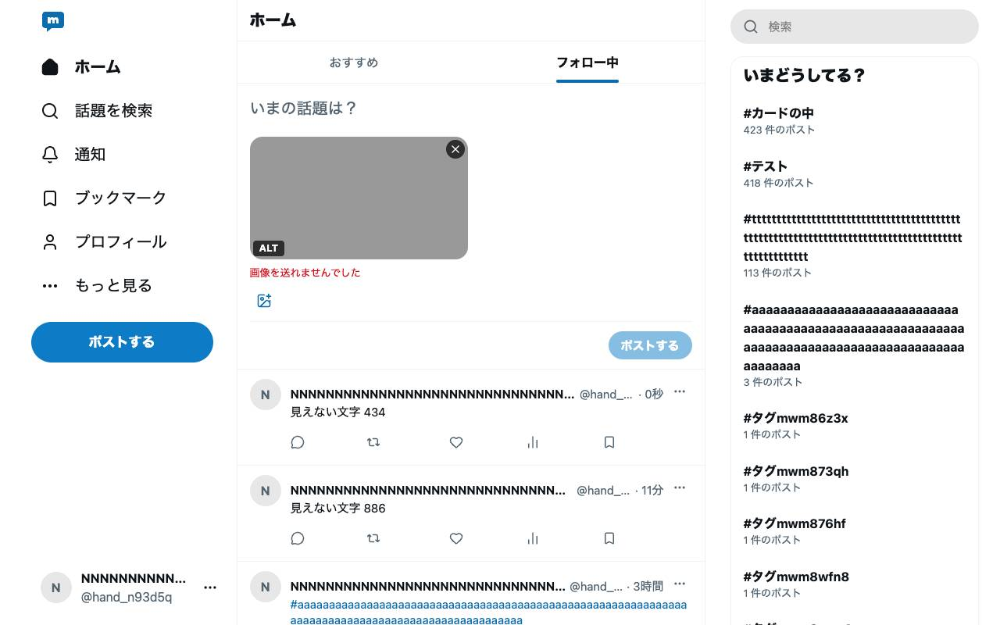
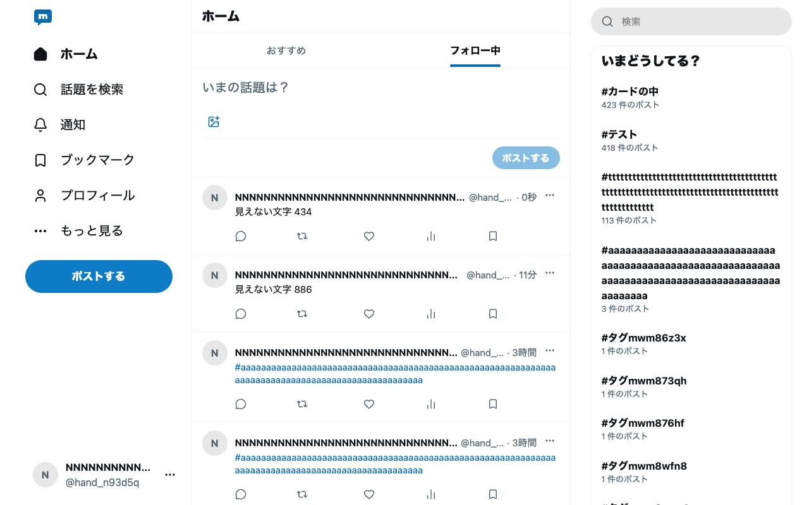
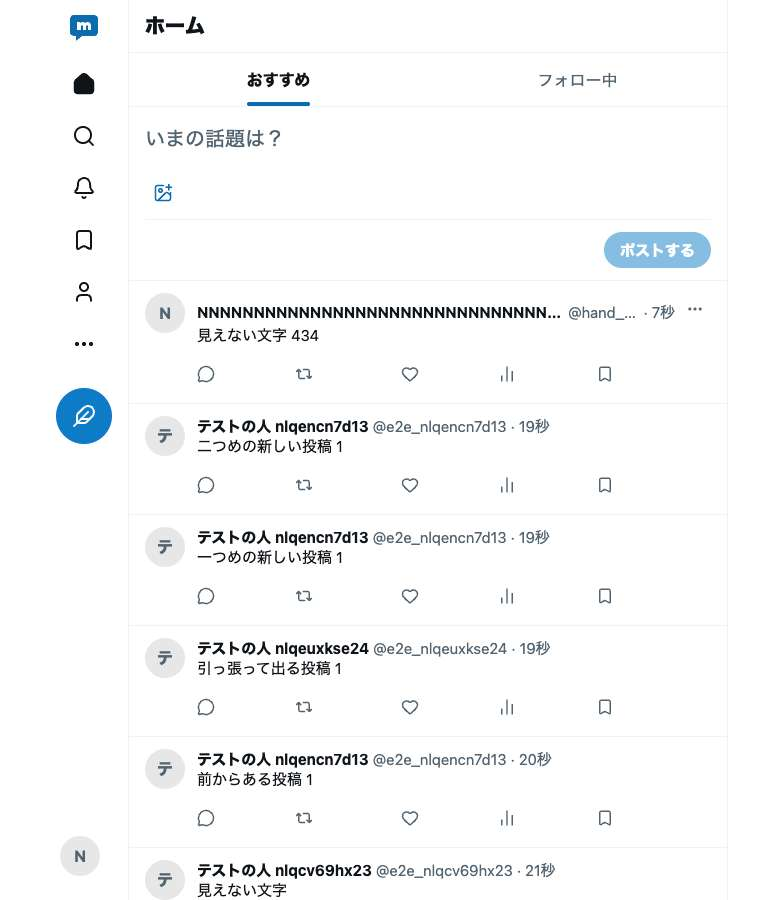
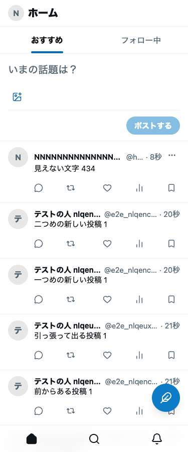

# 試験レポート: 画像の送信に失敗した画像を外しても、「画像を送れませんでした」が残る

## 対象

- issue: [#90](https://github.com/ohta-rh/x-modoki-v2/issues/90)（バグ。#34 の探索的テストの 8 巡目で見つけた）
- commit: `5ce904b`、レビューで直した `20c0f72`・`3ebfa2e`（ブランチ `m1/local-app`、PR #40）
- CI: [実行 44537584475](https://github.com/ohta-rh/x-modoki-v2/actions/runs/44537584475)（成功）
- 日付: 2026-11-19

## 環境

- macOS 26.2、Google Chrome（Playwright 1.65.0 の `channel: 'chrome'`）、Node.js 26.12.0（`.nvmrc` は 24。CI の実行を本当の結果とする）、Docker Compose の PostgreSQL
- 動かし方: `pnpm build && pnpm start -p 3001`。確かめるために登録した架空の人（`hand_n93d5q`、ライト）

## 判定

合格 — 受け入れ条件 3 件のうち 3 件を満たした。

## 受け入れ条件ごとの結果

| # | 条件 | 確かめ方 | 結果 | エビデンス |
|---|---|---|---|---|
| 1 | 送れなかった画像を外して、送れなかった画像が残っていなければ、文言は消える | `image-attachments.test.tsx` › 送れなかった画像を外すと…（#90）、`e2e/media.spec.ts` › 送れなかった画像を外すと、「画像を送れませんでした」も消える（#90） | 合格 | テストの名前のとおり |
| 2 | ほかに送れなかった画像が残っていれば、文言は残る | `image-attachments.test.tsx` › 同じテストの 1 回目に外したところ | 合格 | テストの名前のとおり |
| 3 | CI が緑で、カバレッジが 100% のまま | CI の実行 | 合格 | CI の実行 |

## 自動のテスト

`PORT=3300 pnpm verify` が 0 で終わった（`3ebfa2e`）: 単体のテスト 187 ファイル 1105 本、カバレッジ 4 つとも 100%、画面のテスト 387 本（Chromium・Firefox・WebKit）。CI でも同じ 7 つが通った。

- `20c0f72` の前の 1 回で、WebKit の画像のビューアのテストが 1 本落ちた（触っていない所。単独で 5 回ずつ流すと 20 本とも通る）。手元で 3 つのブラウザを並べて流すときだけに起きる遅さで、原因は分からない。CI では起きていない
- `5ce904b` の前の 1 回で、オフラインのログアウトのテスト（#82）が、メニューを開いてすぐ通信を切るので、あとから読み込むメニュー（ADR-0059）が出ずに落ちた。メニューが出るのを待ってから切る形にした（テストの誤り、3 回ずつ通した）

### TDD の記録

| # | 振る舞い | 先に書いたテスト | 赤（落ちた理由） | 緑にした実装 |
|---|---|---|---|---|
| 1 | 外すと文言が消える（受け入れのテスト） | `e2e/media.spec.ts` › 送れなかった画像を外すと…（#90） | `toHaveCount` `Expected: 0` `Received: 1`（直す前のビルド） | `image-attachments.tsx` |
| 2 | 最後の送れなかった画像と一緒に消え、残れば残る | `image-attachments.test.tsx` › 送れなかった画像を外すと… | `expected 

 to be null` | `image-attachments.tsx`（`remove`） |
| 3 | 外したあとに届いた失敗では出さない（レビュー 2） | 同 › 送っている途中で外した画像の失敗が… | `expected 

 to be null` | 文言を「送れなかった画像があるか」から導く |
| 4 | 「4 枚まで」より送れなかった方を出す（レビュー 3） | 同 › 5 枚選んで「4 枚まで」と出たあとでも… | `waitFor` の中で「画像は 4 枚までです」を受け取った | 送れなかった画像があればその文言を先に |

## コードレビュー

- 判定: APPROVE（2 回目、#89・#90 をまとめて）　範囲: `origin/m1/local-app...20c0f72`（1 回目は `...5ce904b`）　レビューした sub agent: code-reviewer（opus）

| # | 重さ | 指摘 | 確かめた結果 | 対応 |
|---|---|---|---|---|
| 1 | major（1 回目） | 画像の代替テキストは人が入れる文字なのに `cleanText` を通らず、`a\u0000b` の代替テキストで `media.alt` の更新が PostgreSQL に断られ、やり直しても通らない（`create-post.ts:177`） | 再現した（`create-post.test.ts` で 22021） | 直した（`20c0f72`）。`createPost` の始めで代替テキストを整える。テスト: `create-post.test.ts` › 画像の代替テキストからも U+0000 を除き… |
| 2 | minor（1 回目） | 送っている途中で外した画像の失敗があとから届くと、0 枚なのに文言が出る（`image-attachments.tsx:39-42`） | 再現した（単体のテスト） | 直した（`20c0f72`）。文言を「送れなかった画像があるか」から導く。テスト: `image-attachments.test.tsx` › 送っている途中で外した画像の失敗が… |
| 3 | minor（2 回目） | 5 枚選んで「4 枚まで」が出たあとに送れないと、「画像を送れませんでした」が出ない（`image-attachments.tsx:54`、指摘 2 の直し方が生んだ） | 再現した（単体のテスト） | 直した（`3ebfa2e`）。提案のとおり送れなかった方を先に出す。テスト: 同 › 5 枚選んで「4 枚まで」と出たあとでも… |
| 4 | minor（2 回目） | 受け入れ条件の自己紹介の確かめが Zod のスキーマだけで、本物の PostgreSQL での保存のテストが無い | そのとおり（今の失敗は無い） | 足した（`3ebfa2e`）。`update-profile.test.ts` › U+0000 を含む自己紹介は…。スキーマを前の形に戻すと 22021 で落ちることを見た |

## ブラウザでの確認

| URL | 幅 | テーマ | した操作 | 見えた結果 | 画面の写真 |
|---|---|---|---|---|---|
| `/home` | 1280 | ライト | ストレージへの送信を止めて画像を付けた | 「画像を送れませんでした」、ポストするは押せない | `90-failed-1280.jpg` |
| `/home` | 1280 | ライト | 「1 枚目を外す」 | 文言が消える | `90-removed-1280.jpg` |
| `/home` | 768 | ライト | 開いた（変えていない隣の画面） | 崩れない、横にはみ出さない | `home-768.jpg` |
| `/home` | 375 | ライト | 開いた（変えていない隣の画面） | 崩れない、横にはみ出さない | `home-375.jpg` |

- コンソール: エラー 0、警告 0　通信: 失敗 0（`chrome-evidence.mjs` の読み込みと、Playwright の Chrome での操作。わざと止めた画像の送信の失敗は除く）

## 見つけた問題

1. レビューで、外したあとに届く失敗と、「4 枚まで」と重なったときの文言の 2 つの順番の漏れが見つかり、どちらも直した
