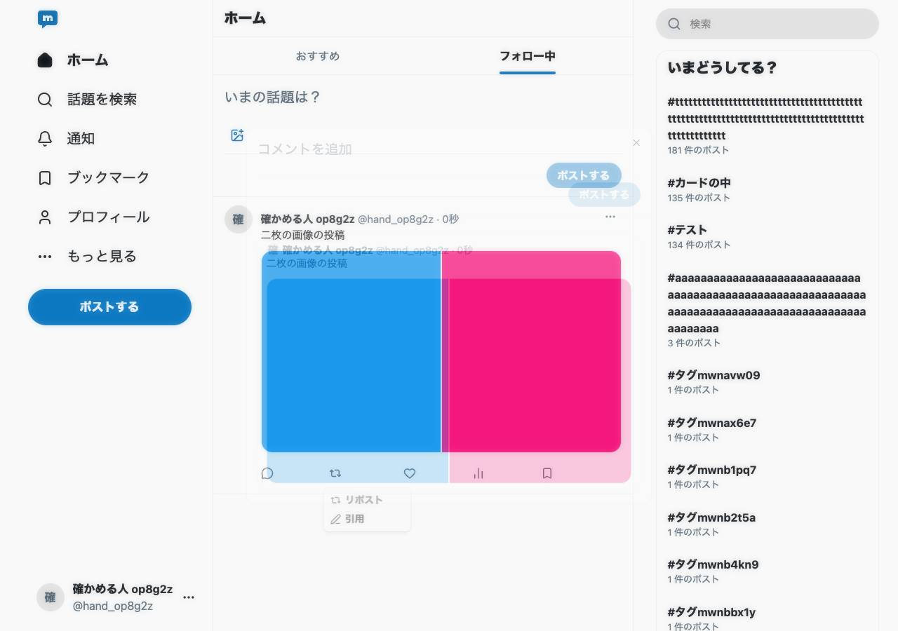
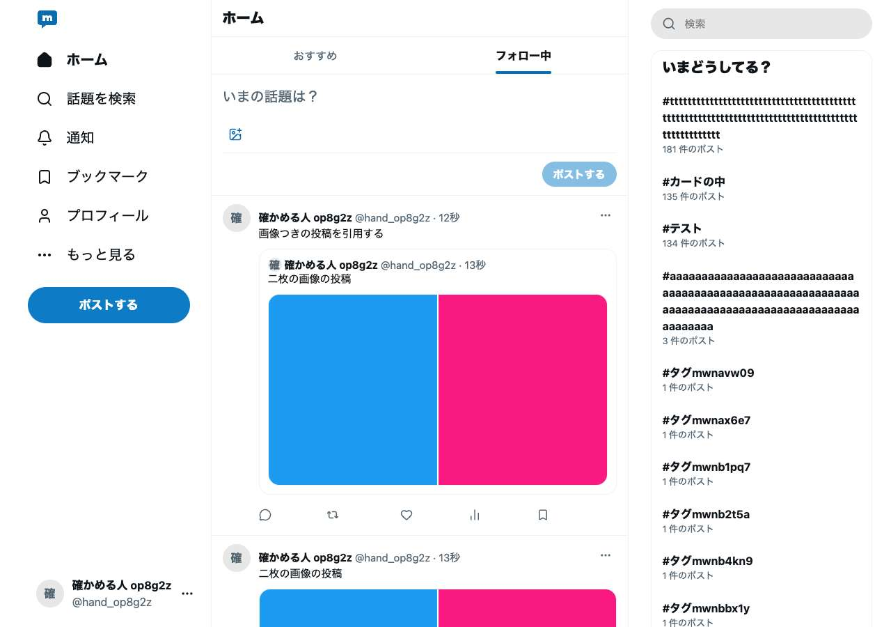
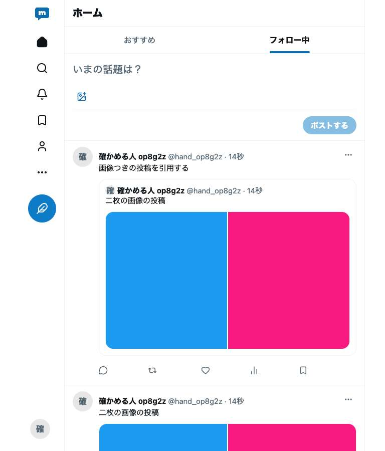
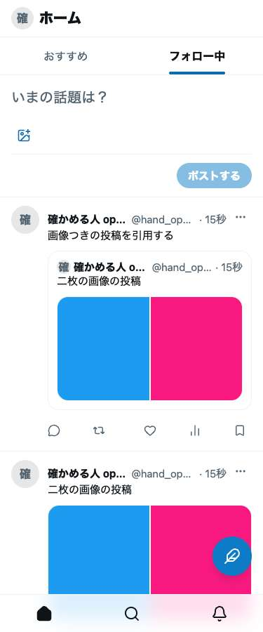
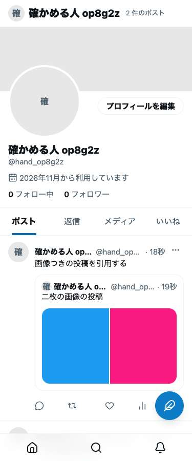

# 試験レポート: 画像つきの投稿を引用すると、引用の中に画像が出ない

## 対象

- issue: [#115](https://github.com/ohta-rh/x-modoki-v2/issues/115)（バグ。ユーザーが 2026-11-20 に報告した）
- commit: `a5c141e`、レビューで足した `4a3bdfa`（ブランチ `m1/local-app`、PR #40）
- CI: [実行 44701498479](https://github.com/ohta-rh/x-modoki-v2/actions/runs/44701498479)（成功。範囲は full、`verify` 4.1 分、画面のテストは Chromium 4 分・Firefox 5.9 分・WebKit 9 分）
- 日付: 2026-11-20

## 環境

- macOS 26.2、Google Chrome（Playwright 1.65.0 の `channel: 'chrome'`）、Node.js 26.12.0（`.nvmrc` は 24。CI の実行を本当の結果とする）、Docker Compose の PostgreSQL と Garage
- 動かし方: `pnpm build && pnpm start -p 3300`。確かめるために登録した架空の人（`hand_op8g2z`、ライト）。ストレージが画像の送信を許す送り元は `localhost:3000` と `localhost:3300` だけなので（`scripts/lib/storage-cors.mjs`）、3001 ではなく 3300 で動かした

## 判定

合格 — 受け入れ条件 5 件のうち 5 件を満たした。

## 受け入れ条件ごとの結果

| # | 条件 | 確かめ方 | 結果 | エビデンス |
|---|---|---|---|---|
| 1 | タイムラインと詳細とダイアログで、引用の中に引用した投稿の画像が全部、順に、代わりの文つきで出る | `e2e/repost-quote.spec.ts` › 画像つきの投稿を引用すると、引用の中に画像が出る（3 つのブラウザ）、`hydrate.test.ts` › 引用した投稿の画像も、位置の順に…（#115）、本物の Chrome で 2 枚の投稿を引用 | 合格 | `115-dialog-1280.jpg`、`home-1280.jpg` |
| 2 | 外側の投稿と同じ並べ方でカードに収まり、押すと引用した投稿が開く | 同じ e2e（カードの枠の内側にあること、押すと引用した投稿の詳細）、`quoted-card.test.tsx` › 引用した投稿の画像を、本文の下に順に出す。押すとその投稿へ（#115）、本物の Chrome で 1280 / 768 / 375px | 合格 | `home-768.jpg`、`home-375.jpg`、`profile-375.jpg` |
| 3 | 削除された投稿の引用は印だけで画像は出ない | `hydrate.test.ts` › 引用は quoted に元の投稿を持つ。元が消されていれば印だけ… | 合格 | テストの名前のとおり |
| 4 | 1 つの文で取る形は変えない | `post-rows.ts` の差分（引用の画像は同じ文の中の問い合わせ）、`test/home-render-queries.test.ts` が通る | 合格 | テストの名前のとおり |
| 5 | CI が緑で、カバレッジが 100% のまま | CI の実行 | 合格 | CI の実行 |

## 自動のテスト

`PORT=3300 pnpm verify` が 0 で終わった（`4a3bdfa` の木）: 単体のテスト 192 ファイル 1172 本、カバレッジ 4 つとも 100%、画面のテスト 390 本（Chromium・Firefox・WebKit）。

- 1 回目の `pnpm verify` で、触っていない `e2e/narrow.spec.ts` › 人が入れる全部の欄が長くても…（#80）が Firefox で 1 回だけ `NS_BINDING_ABORTED` で落ちた（ホストのロードアベレージ 41）。そのテストは `router.refresh` の終わりを待ってから移っているので、#50 の形ではない。Firefox で 10 回繰り返すと 10 回とも通り、再現しなかった。原因は分からない。2 回目の `pnpm verify` は全部通った

### TDD の記録

| # | 振る舞い | 先に書いたテスト | 赤（落ちた理由） | 緑にした実装 |
|---|---|---|---|---|
| 1 | 引用の中に画像が出て、押すと引用した投稿が開く（受け入れのテスト） | `e2e/repost-quote.spec.ts` › 画像つきの投稿を引用すると、引用の中に画像が出る | `getByRole('dialog', { name: '引用' }).getByRole('article', { name: '引用した投稿' }).getByRole('img', { name: '青い四角' })` `Expected: visible` `element(s) not found`（直す前のビルド） | 下の 2 と 3 |
| 2 | 引用した投稿の画像を、位置の順に URL・縦横・代わりの文で返す | `hydrate.test.ts` › 引用した投稿の画像も、位置の順に…（#115） | `expected undefined to deeply equal [ { …(4) }, { …(4) } ]` | `post-rows.ts`（`imagesOf` を引用の `json_build_object` にも）、`types.ts` |
| 3 | 引用のカードが画像を本文の下に描き、押すと引用した投稿へ | `quoted-card.test.tsx` › 引用した投稿の画像を、本文の下に順に出す…（#115） | `expected [] to deeply equal [ '一枚目', '二枚目' ]` | `quoted-card.tsx`（`PostMedia`）、`quote-dialog.tsx` |
| 4 | 引用する投稿の詳細でも、引用した投稿の画像を返す（レビュー 1） | `get-post-detail.test.ts` › 引用する投稿の詳細では…（#115） | `expected undefined to deeply equal [ { …(4) } ]`（直す前の `post-rows.ts` に戻して流した。実装は 2 と同じ所なので、テストを後から足した形） | 2 と同じ |

- `hydrate.test.ts` の引用の形のテストは、`quoted` に `media: []` が加わったので期待を合わせた（仕様の変更。テストの誤りではない）

## コードレビュー

- 判定: APPROVE（2 回目、範囲: `origin/m1/local-app...4a3bdfa`、指摘なし）。1 回目は CHANGES_REQUESTED（範囲: `...a5c141e`）　レビューした sub agent: code-reviewer（opus）

| # | 重さ | 指摘 | 確かめた結果 | 対応 |
|---|---|---|---|---|
| 1 | major（1 回目） | 受け入れ条件 1 は「投稿の詳細」でも出ることを求めるのに、引用する投稿の詳細（`get-post-detail` → `MainPost` → `QuotedCard`）を確かめるテストが無い | そのとおり | 直した。`get-post-detail.test.ts` › 引用する投稿の詳細では、引用した投稿の画像も返す（#115）を足し、直す前の `post-rows.ts` に戻すと `expected undefined to deeply equal [ { …(4) } ]` で落ちるのを見た。e2e にも、引用する投稿の詳細で画像が出て、押すと引用した投稿が開く一歩を足した |

## ブラウザでの確認

| URL | 幅 | テーマ | した操作 | 見えた結果 | 画面の写真 |
|---|---|---|---|---|---|
| `/home?tab=following` | 1280 | ライト | 2 枚の画像（青・桃色、代わりの文つき）で投稿し、「引用」を開いた | ダイアログの引用の中に 2 枚が並ぶ | `115-dialog-1280.jpg` |
| `/home?tab=following` | 1280 | ライト | 引用を投稿して読み込み直した | 引用のカードの中に 2 枚が、16px の角で、カードの内側に並ぶ | `home-1280.jpg` |
| `/home?tab=following` | 768 | ライト | 開いた | 同じ。横にはみ出さない | `home-768.jpg` |
| `/home?tab=following` | 375 | ライト | 開いた | 同じ。横にはみ出さない | `home-375.jpg` |
| `/hand_op8g2z` | 375 | ライト | 開いた | プロフィールの一覧でも引用の中に画像が出る | `profile-375.jpg` |
| 引用の中の画像を押した先 | 1280 | ライト | 引用の中の「青い四角」を押した | 引用した投稿（「二枚の画像の投稿」）の詳細が開き、外側の投稿は開かない | 操作の記録（`openedHasOriginal: true`、`openedHasQuote: false`） |

- コンソール: エラー 0、警告 0　通信: 失敗 0（`chrome-evidence.mjs` の読み込み。操作のときの `ERR_ABORTED` は、登録のあとの移動と読み込み直しで取り消された通信だけ）

## 見つけた問題

1. 引用した投稿の画像が、問い合わせ・型・表示のどこにも無かった（この PBI で直した）
2. ポート 3001 で動かすと、画像の送信がストレージの CORS で断られる（許しているのは 3000 と 3300）。手元の確かめ方の制約で、この PBI の範囲の外
